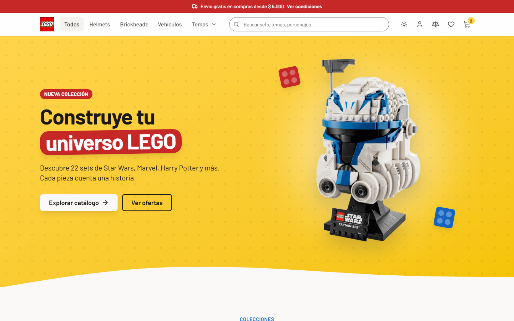
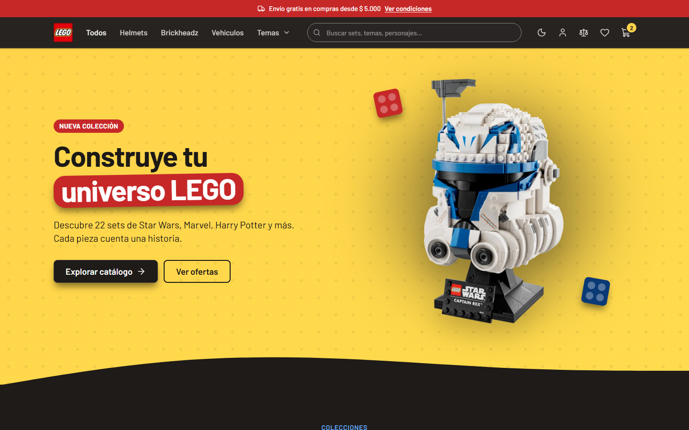
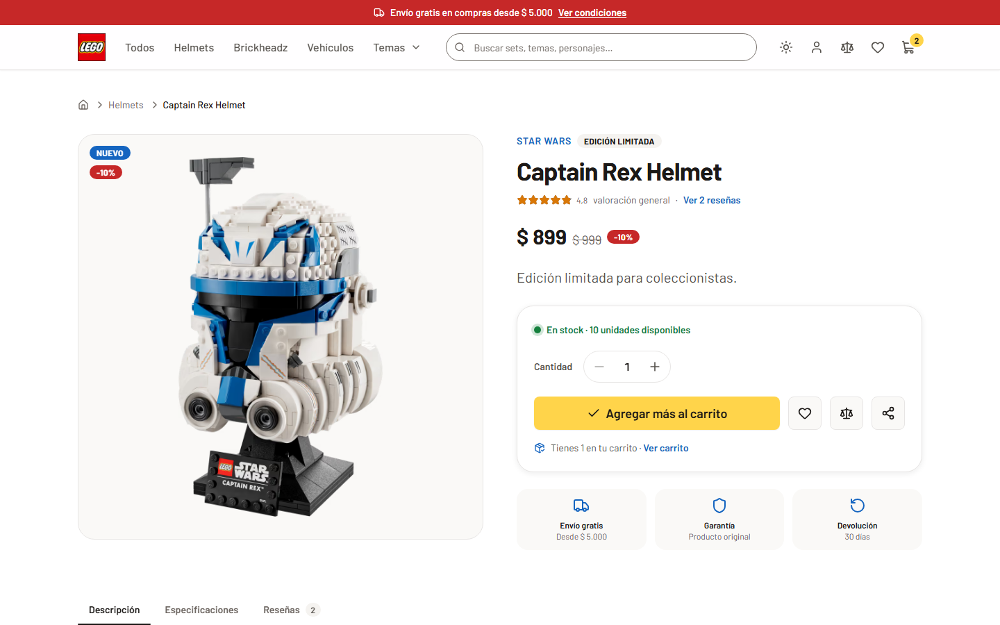
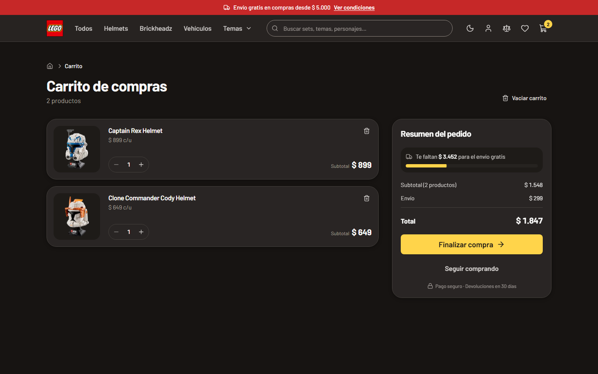
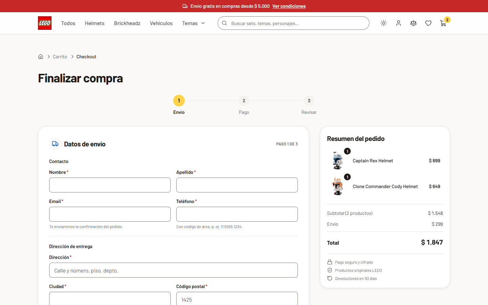

# LEGO Store

Tienda online de sets LEGO (proyecto de portfolio): catálogo con búsqueda e
infinite scroll, ficha de producto, carrito, lista de deseos, comparador de
hasta 4 productos y un checkout en pasos con Mercado Pago (o Stripe). Toda la UI está en
español, tiene modo oscuro y apunta a WCAG 2.1 AA.

El catálogo vive en PostgreSQL (Prisma) y todas las lecturas pasan por una sola
capa (`src/lib/api`). Hay cuentas de usuario (registro, login, perfil, roles
cliente/admin) con Auth.js, carrito y favoritos por cuenta, reseñas, y pedidos
pagados con Mercado Pago (tarjetas en cuotas, efectivo, dinero en cuenta; Stripe
como alternativa) con email de confirmación (Resend) y "Mis pedidos", y un panel de admin (productos, stock, pedidos con envío, entrega y
cancelación con reembolso, moderación de reseñas). El diseño está en
`docs/superpowers/specs/2026-10-17-backend-completo-design.md`. La app
necesita Postgres para correr: ver [Puesta en marcha local del backend](#puesta-en-marcha-local-del-backend).

<table>
  <tr>
    <td></td>
    <td></td>
  </tr>
  <tr>
    <td></td>
    <td></td>
  </tr>
  <tr>
    <td></td>
    <td></td>
  </tr>
</table>

Las capturas se regeneran con `npm run screenshots` contra un build de
producción en marcha (`npm run build && npm start`).

## Stack

- **Next.js 16** (App Router, Turbopack) + **React 19**, TypeScript 5.9
- **Tailwind CSS 4** con tokens de diseño en `@theme` (`src/app/globals.css`)
- Primitivos estilo **shadcn/ui sobre Base UI** (`src/components/ui`)
- **motion** (`motion/react`, vía `LazyMotion` + `m.*`) para animaciones, con presets en `src/lib/motion.ts`
- **Auth.js** (`next-auth@5.0.0-beta.32`, compatible con Next 16 y React 19): email + contraseña (bcrypt) y Google opcional, sesiones JWT
- **PostgreSQL 17** + **Prisma 7** (cliente `prisma-client` generado en `src/generated/prisma`, driver adapter `@prisma/adapter-pg`)
- **Zustand** (estado del cliente persistido), **TanStack Query** (datos en islas cliente)
- **Mercado Pago** (`mercadopago` 3 en el servidor, Payment Brick con `@mercadopago/sdk-react` 1, Checkout Pro para dinero en cuenta), **Stripe** como alternativa (`stripe` 23, Payment Element con `@stripe/react-stripe-js` 7 y ConfirmationTokens) y **Resend** (emails; sin claves se loguean a consola)
- **React Hook Form** + **Zod** (checkout, contacto y reseñas; se cargan solo donde se usan), **sonner** (toasts)
- Barlow servida por `next/font` (self-hosted y precargada)
- **Vitest** (unit + Storybook), **Playwright** (E2E), **Storybook 10** con a11y

Requiere Node `^22.13` o `>=24`.

## Scripts

| Comando | Qué hace |
| --- | --- |
| `npm run dev` | Servidor de desarrollo en http://localhost:3000 (necesita la base, ver abajo) |
| `npm run build` / `npm start` | Build de producción y servidor (el build lee la base: la lista de categorías y los ids de las rutas; las páginas se renderizan por pedido) |
| `npm run db:up` / `npm run db:down` | Levanta / detiene Postgres en Docker (bases `lego_store` y `lego_store_test`) |
| `npm run db:migrate` | `prisma migrate dev`: aplica migraciones pendientes en dev (y crea una nueva si cambiaste el schema) |
| `npm run db:deploy` | `prisma migrate deploy`: solo aplica migraciones (CI, producción) |
| `npm run db:seed` | Carga categorías, productos, reseñas de ejemplo y el admin (idempotente) |
| `npm run db:reset` | Borra la base de dev, reaplica las migraciones y vuelve a sembrar (pide confirmación) |
| `npm run db:studio` | Prisma Studio para mirar y editar la base |
| `npm run db:generate` | Regenera el cliente de Prisma (también corre en `postinstall`) |
| `npm run lint` | ESLint (incluye las guardas del sistema de diseño) |
| `npx tsc --noEmit` | Chequeo de tipos |
| `npm test` | Vitest en modo watch (`npx vitest run` para una corrida: unit + integración + Storybook) |
| `npm run test:unit` / `npm run test:integration` | Solo los tests unitarios (sin base) / solo los de integración (base de test) |
| `npm run test:db:setup` | Reconstruye la base de test desde cero (si quedó desfasada de las migraciones) |
| `npm run test:coverage` | Cobertura de los tests unitarios |
| `npm run test:e2e` | Playwright: proyecto `chromium` contra `npm run dev` y proyecto `prod` contra un build en el puerto 3100 (los levanta si no están) |
| `npm run test:e2e:stripe` | Checkout contra Stripe en modo test real (Payment Element, 3D Secure, webhook); se saltea sin claves de test (ver «Checkout, pagos y pedidos») |
| `npm run storybook` / `npm run build-storybook` | Storybook en http://localhost:6006 / build estático |
| `npm run size -- <url>` | JS de primera carga (gzip) por ruta clave contra su presupuesto, sobre un `npm start` en marcha |
| `npm run screenshots` | Regenera las capturas de `screenshots/` (`BASE_URL` para otro origen) |

## Estructura

```
prisma/
  schema.prisma        Modelo de datos (usuarios y tablas de Auth.js, catálogo,
                       carrito, favoritos, reseñas, pedidos, eventos de pago)
  migrations/          Migraciones SQL (las restricciones CHECK van escritas a mano)
  seed.ts seed/        Seed idempotente (catálogo de src/data, reseñas y pedidos de ejemplo, admin)
prisma.config.ts       Config del CLI de Prisma (URL de la base, seed)
docker-compose.yml     Postgres local (dev + test)
src/
  app/                 Rutas (App Router). Páginas = Server Components.
    (info)/            Ayuda y la tienda: faq, envios, devoluciones, contacto,
                       nosotros, terminos, privacidad (layout con menú lateral)
    (auth)/            /login y /register + sus Server Actions (login, registro)
    account/           /account: pedidos recientes, perfil, contraseña, sesión (+ Server Actions)
      orders/          /account/orders (Mis pedidos) y /account/orders/[id] (detalle)
    admin/             Panel de admin (solo ADMIN): resumen, products/ (lista, nuevo, [id]),
                       orders/ (lista, [id]) y reviews/ (moderación)
    forbidden.tsx      Página 403 (forbidden())
    api/               Route Handlers para las islas cliente
      products/        GET /api/products (filtros, orden, paginación)
      products/by-ids/ GET /api/products/by-ids?ids=1,2
      products/facets/ GET /api/products/facets (conteos en vivo de los filtros)
      search/          GET /api/search?q= (autocompletado)
      auth/[...nextauth]/  Endpoints de Auth.js (OAuth, sesión, CSRF)
      checkout/orders/ POST: preparar el pedido · GET [id]: estado · POST [id]/pay: pagar ·
                       POST [id]/sync: consultar el pago a Mercado Pago (vuelta de Checkout Pro)
      webhooks/mercadopago/  POST: notificaciones de Mercado Pago (x-signature verificada)
      stripe/webhook/  POST: eventos de Stripe (firma verificada)
      test/mercadopago/  POST: solo con PAYMENTS_MOCK (E2E): lo que Mercado Pago haría solo
      cron/expire-orders/  GET con CRON_SECRET: cancela pedidos pendientes viejos
    cart/ wishlist/ compare/ search/ category/ item/
    checkout/_components/  Pasos, resumen y confirmación del checkout (mercadopago/: Brick y opciones de prueba)
    checkout/pedido/[orderId]/  Vuelta desde Mercado Pago: consulta el pago y sigue el pedido
  components/
    ui/                Primitivos del sistema de diseño (barrel index.ts)
    layout/            Navbar, Footer, PageHeader, menú de cuenta, menús y paneles (carga diferida)
    auth/ account/     Formularios de login/registro y de /account
    admin/             Panel de admin: navegación, tablas, formulario de producto,
                       stock en línea, confirmaciones (ConfirmAction)
    product/           Tarjeta, grilla, catálogo y filtros, ficha, galería, reseñas (reviews/)
    cart/ wishlist/ compare/ search/ home/ info/ forms/ icons/
    motion/            Reveal / Stagger para Server Components
  data/                Fuente del seed (la app no lo lee: ESLint lo impide)
  generated/prisma/    Cliente de Prisma generado (gitignored)
  hooks/               useProductActions, useProductsByIds, useInfiniteScroll…
  lib/
    api/               Gateway de datos (server-only): consultas Prisma + caché de Next
    db/                Cliente de Prisma (instancia única en el servidor)
    auth/              Auth.js (index.ts), sesión y permisos (session.ts: getCurrentUser,
                       requireUser, requireAdmin, authorizeRequest), cuentas (accounts.ts),
                       adapter de Prisma, callbackUrl seguro, hash de contraseñas (bcrypt),
                       actions.ts (logout y Google, que usan el navbar y /account)
    rate-limit/        Rate limiting en Postgres (login, registro, reseñas, checkout)
    orders/            Pedidos: checkout en el servidor (Stripe: checkout.ts, webhook.ts; Mercado Pago:
                       mercadopago.ts), limpieza, acceso, consultas, formato, efectos (emails, caché)
    payments/          Proveedores de pago: la interfaz PaymentProvider, Mercado Pago (mercadopago/:
                       SDK, firma de webhooks, estados, mock), Stripe y su mock (PAYMENTS_MOCK), configuración
    email/             Envío (Resend o consola) y plantillas de los emails de pedidos
    admin/             Panel de admin: productos, pedidos (transiciones, reembolso),
                       reseñas, resumen; data.ts (lecturas que verifican el rol) y
                       actions.ts (Server Actions)
    images.ts          URLs de imágenes permitidas (las mismas que next.config.mjs)
    api-client.ts      Llamadas del navegador a /api/*
    productQuery.ts    ProductQuery <-> URL search params
    pricing.ts         Subtotal, envío y totales (carrito y checkout)
    argentina.ts       Provincias y zona horaria de la tienda
    flyToCart.ts       Animación "vuela al carrito" (Web Animations API)
    motion.ts motion-features.ts theme.ts metadata.ts utils.ts validations/
  stores/              Zustand: cart, wishlist, compare, recentlyViewed, theme, checkout, ui
  types/               Tipos de dominio (única fuente)
src/proxy.ts           /account y /admin sin sesión van a /login; 404 reales de /item y /category
__tests__/             Tests unitarios y de componentes (Vitest + Testing Library)
  integration/         Tests contra la base de test (lib/api, Route Handlers, proxy, seed, restricciones)
e2e/                   Tests de Playwright (e2e/prod: contra el build de producción)
scripts/               Presupuesto de JS y capturas del README
```

## Arquitectura de datos

- **Lecturas**: Server Components llaman a `@/lib/api` (`getPaginatedProducts`,
  `getProductById`, `searchProducts`, `getFilterOptions`, `getCategories`,
  `getRelatedProducts`, `getProductsByIds`…). Son funciones `async` con argumentos y
  resultados serializables, implementadas con Prisma (`src/lib/api/catalog.ts`):
  filtros, búsqueda, orden y paginación corren en Postgres. Importar `@/data` desde
  `src/` es un error de lint: es solo la fuente del seed.
- **Caché**: cada lectura del catálogo pasa por el data cache de Next
  (`unstable_cache`, el modelo previo a Cache Components, que la app no activa) con
  tags: `products` (todo el catálogo), `product:<id>` y `categories`. Las páginas
  se renderizan por pedido (el navbar depende de la sesión, ver
  [Cuentas y sesiones](#cuentas-y-sesiones)), pero sus lecturas del catálogo salen
  de esa caché hasta que una escritura llama a `invalidateCatalog()`
  (`src/lib/api/cache.ts`, vencimiento inmediato) o, desde una Server Action cuyo
  usuario tiene que ver su cambio al instante (una reseña), a `updateCatalog()`
  (`updateTag`: Next re-renderiza la página actual en la misma respuesta). Hay además una revalidación por tiempo de 1 h como red de
  seguridad. Lo que depende del usuario (carrito, pedidos, cuenta) no pasa por esta
  caché.
- **Islas cliente** (infinite scroll, autocompletado, comparador, favoritos,
  vistos recientemente) usan los Route Handlers de `src/app/api` vía
  `@/lib/api-client` y React Query. El catálogo nunca viaja en el bundle.
- **Búsqueda**: un solo algoritmo (`src/lib/api/search.ts`): todos los términos
  deben aparecer en nombre, tema, categoría o descripción, sin distinguir
  mayúsculas ni acentos. Cada producto guarda ese texto ya normalizado
  (`Product.searchText`, sin acentos y en minúsculas) y la búsqueda es un `LIKE`
  por término, sin extensiones de Postgres; el ranking (términos en el nombre)
  se aplica sobre esas filas. Toda escritura de un producto recalcula esas
  columnas con `productSearchColumns()`.
- **Rating**: `Product.rating` y `Product.reviewCount` son columnas cacheadas del
  promedio y la cantidad de reseñas (`refreshProductRatings()`); un producto sin
  reseñas tiene rating 0 y va al final de "Destacados" y "Mejor calificados".

## Cuentas y sesiones

- **Auth.js v5** (`src/lib/auth/index.ts`): email + contraseña (Credentials, hash
  bcrypt) y Google solo si están `AUTH_GOOGLE_ID` y `AUTH_GOOGLE_SECRET` (si no,
  el botón no aparece). Páginas propias: `/login`, `/register`, `/account`
  (nombre, contraseña, cerrar sesión) y `/admin`.
- **Sesiones JWT** en una cookie HttpOnly, no sesiones en base: Credentials solo
  admite JWT y leer la sesión no cuesta una consulta (el navbar la lee en cada
  página). Lo que un JWT no tiene, revocación inmediata, se cubre en el servidor:
  el token lleva la `sessionVersion` del usuario y `getCurrentUser()` la compara
  con la base en cada página, acción y ruta protegida. Cambiar la contraseña la
  incrementa, así que se cierran las sesiones de los otros dispositivos. Un token
  viejo no puede revivir pidiendo un refresh (`POST /api/auth/session` está abierto
  a cualquier cliente): el refresh solo copia nombre, email y rol de la base, y pasar
  a la versión nueva exige una renovación firmada con `AUTH_SECRET` que arma la
  acción de cambio de contraseña para su propia sesión (`session-token.ts`). El rol
  también sale siempre de la base, nunca del token.
- **Cerrar sesión** (cliente) borra la cookie de ese navegador: los otros
  dispositivos siguen con su sesión (lo esperable al cerrar sesión en el celular,
  por ejemplo). Una copia del token tomada antes (cookie filtrada, compu
  compartida) seguiría valiendo hasta que vence (30 días), así que `/account`
  ofrece **"Cerrar sesión en todos los dispositivos"** (`logoutEverywhereAction`):
  incrementa `sessionVersion` y cualquier copia deja de valer en el siguiente
  pedido. Para un **admin**, cerrar sesión siempre hace eso: un token de admin no
  sobrevive a su logout. Cambiar la contraseña también cierra las demás sesiones.
  Es un trade-off aceptado: incrementar `sessionVersion` en cada logout de cliente
  cerraría también sus otros dispositivos, y una lista de tokens revocados (jti)
  costaría una consulta más por pedido.
- **La sesión no se renueva sola**: `proxy.ts` decide con la cookie pero no escribe
  cookies (el wrapper de Auth.js re-emite la cookie en cada pedido, y un prefetch
  de `/account` que respondiera después del logout la volvía a escribir y deshacía
  el logout). Por eso el token dura 30 días desde el ingreso o desde la última
  renovación del servidor (cambio de nombre o de contraseña), no 30 días desde la
  última visita. Los links a `/account` y `/admin` de los menús tampoco hacen prefetch.
- **Roles** USER / ADMIN: el email de `ADMIN_EMAIL` recibe ADMIN en el seed y al
  entrar por primera vez con Google (solo con el email verificado por Google). El
  formulario de registro **no** acepta `ADMIN_EMAIL` (responde como si ya existiera
  la cuenta): como no hay verificación de email, quien se registrara primero con esa
  dirección en una base nueva sería admin. Esto se aparta del spec («recibe ADMIN…
  al registrarse»); la cuenta admin sale solo del seed (o de Google con email
  verificado). El servidor deja un aviso en el log cuando rechaza ese registro. Los emails se guardan siempre en minúsculas (`CHECK` en la
  base); `normalizeEmail()` corre antes de cada escritura y búsqueda, incluido el
  adapter de OAuth.
- **El registro dice si un email ya tiene cuenta** ("Ya existe una cuenta con ese
  email"); el login no (mismo mensaje y un bcrypt de relleno para emails
  desconocidos). Es el trade-off habitual de una tienda sin verificación de email:
  un registro que no lo revele necesita mandar un email a la dirección existente.
  Lo frena el límite de 20 registros por IP por hora.
- **Protección en dos capas**: `src/proxy.ts` manda a `/login?callbackUrl=…` a quien
  pide `/account/*` o `/admin/*` sin sesión (chequeo optimista: solo mira la cookie).
  La autorización real está en el servidor: cada página, Server Action y Route
  Handler protegida llama a `requireUser()`, `requireAdmin()` (403 con
  `forbidden()`, `experimental.authInterrupts`) o `authorizeRequest()` (401/403 en
  JSON para Route Handlers). Las funciones de datos de admin verifican el rol ellas
  mismas.
- **callbackUrl**: solo rutas del mismo sitio (`safeCallbackUrl`): otro origen,
  `//host`, `/\host`, caracteres de control, `/login`, `/register` y `/api/*` vuelven
  al inicio. Se revisa también el resultado ya normalizado, porque `/.//host` o
  `/a/..//host` se convierten en `//host` al resolver los segmentos con punto.
- **Rate limiting** (`src/lib/rate-limit`): ventana fija con el contador en Postgres
  (tabla `RateLimit`, un `INSERT … ON CONFLICT` atómico con el reloj de la base), así
  que vale entre instancias y en serverless. Login, en orden y cortando en el primer
  rechazo (un intento rechazado no suma en los límites siguientes): 5 intentos por
  cuenta y origen cada 15 min (un login correcto los borra), 50 por IP cada 15 min y
  30 por cuenta por hora desde cualquier IP. El origen es la IP, o el dispositivo si
  el navegador ya ingresó antes a esa cuenta: una cookie HttpOnly firmada con
  `AUTH_SECRET` (`known-device.ts`). Los dispositivos conocidos solo pasan por su
  propio límite de 5, así que quien adivina contraseñas llena los contadores
  compartidos pero no deja afuera al dueño en los navegadores que ya usa (un
  dispositivo nuevo del dueño sí puede esperar hasta una hora si alguien llenó el
  límite por cuenta desde muchas IPs). Registro: 20 cuentas por IP por hora;
  contraseña actual en `/account`: 5 cada 15 min; reseñas nuevas: 10 por usuario por
  hora; votos "útil": 60 por usuario cada 15 min; cambios de carrito y favoritos:
  300 por usuario cada 15 min, y 30 fusiones al ingresar por hora (cada una escribe
  hasta 200 + 200 filas). Un dispositivo nuevo bloqueado por el límite ve "esperá
  unos minutos" sin el tiempo exacto, y no hay desbloqueo por email (no hay flujo de
  recuperación de contraseña todavía). Para limitar algo nuevo (contacto,
  newsletter) se agrega una entrada en `rateLimits` y se llama `consume(sujeto)`. `memoryStore()` existe para tests: no se comparte entre
  instancias.
- **La IP del cliente** (`clientIp()`) solo sale de headers que pone
  infraestructura de confianza, porque `X-Forwarded-For` lo puede mandar cualquiera
  (`next dev` y `next start` lo dejan pasar tal cual): en Vercel, los headers que su
  edge reescribe; detrás de tus proxies, `TRUSTED_PROXY_HOPS=N` toma la entrada de
  `X-Forwarded-For` que agregó el proxy más externo (N desde la derecha). Sin ninguna
  de las dos (desarrollo, un `next start` expuesto directo) no se confía en ninguna
  IP: todos los clientes comparten el bucket `unknown`, así que los límites por IP
  valen para todo el sitio junto (estricto, pero puede frenar a gente legítima: un
  self-host público tiene que estar detrás de un proxy que reescriba
  `X-Forwarded-For` y definir `TRUSTED_PROXY_HOPS`). En ese modo una sola persona
  puede agotar el límite compartido y bloquear el login desde navegadores nuevos,
  el registro y el checkout de invitado para todos; por eso un servidor de
  producción sin `VERCEL=1` ni `TRUSTED_PROXY_HOPS` lo avisa en el log al arrancar
  (`src/instrumentation.ts`). Los límites por cuenta y los dispositivos conocidos no
  dependen de la IP.
- **Navbar sin parpadeo**: el layout raíz lee la sesión (`getCurrentUser()`) y el
  navbar llega del servidor ya con el menú de cuenta o el link de ingreso. El costo:
  todas las páginas se renderizan por pedido en vez de prerenderizarse (ver
  [Rendimiento](#rendimiento)).
- **Configuración**: `AUTH_SECRET` es obligatoria. Sin ella Auth.js falla cerrado:
  todas las páginas se ven sin sesión, nadie puede ingresar y `/login` y `/register`
  avisan que falta. Fuera de Vercel, `next start` necesita `AUTH_TRUST_HOST=true`
  (o `AUTH_URL`) para que Auth.js acepte el host.

## Carrito, favoritos y reseñas

- **Visitantes**: carrito y favoritos viven en localStorage, como siempre. Al cargar
  la página, las líneas del carrito toman precio y stock actuales del catálogo
  (`/api/products/by-ids`); las de productos borrados o agotados se quitan.
- **Con sesión** el servidor es la verdad (`CartItem`, `WishlistItem`). Los stores de
  Zustand siguen siendo la capa de UI y guardan de quién es la copia (`owner`).
  `<ListsSync />` (`src/components/layout/ListsSync.tsx`, reglas en
  `src/lib/lists/sync-plan.ts`):
  - al **ingresar**, el carrito y los favoritos del visitante se fusionan con los de
    la cuenta (`mergeListsAction`): cantidades sumadas y topeadas por el stock,
    favoritos unidos, productos inexistentes o agotados descartados. Pasa una sola
    vez: después la copia es de la cuenta y no se vuelve a sumar. La fusión es
    **idempotente**: el navegador guarda lo que manda con un token aleatorio
    (`src/lib/lists/pending-merge.ts`) hasta adoptar la respuesta, un reintento
    reenvía lo mismo con el mismo token y el servidor lo registra por usuario en la
    misma transacción (tabla `ListMerge`, `src/lib/lists/merge.ts`), así que nunca
    suma dos veces. Las sincronizaciones de la cuenta corren de a una (la que pide
    la pestaña al volver espera a la fusión) y lo que el usuario cambió mientras la
    fusión estaba en curso se reaplica encima del resultado;
  - en cada carga y al volver a la pestaña recarga las listas de la cuenta
    (`GET /api/lists`, sin caché): precios, nombres y stock actuales, nunca un
    snapshot. Una recarga que se cruzó con un cambio en curso se descarta;
  - al **cerrar sesión** (o si la sesión vence) borra la copia de la cuenta de ese
    navegador. La copia de otra cuenta nunca se fusiona.
- **Cambios optimistas** (`src/stores/listsRemote.ts`): el store cambia al instante y
  manda la Server Action (`src/lib/lists/actions.ts`: zod, sesión propia, solo ids y
  cantidades). La respuesta trae la línea como la tiene el servidor (cantidad
  topeada por stock, precio actual) y reemplaza la local; si el servidor la rechaza
  o no responde, la línea vuelve a como estaba y un toast lo explica. Si llegan
  respuestas viejas después de un cambio más nuevo de la misma línea, se ignoran.
- **Stock**: toda escritura topea la cantidad con el stock en la misma transacción
  (los incrementos son atómicos en SQL, dos pestañas no se pisan). Una línea cuyo
  producto se agotó queda guardada pero no se lista ni llega al checkout; vuelve si
  hay reposición.
- **Reseñas** (`src/lib/reviews`): crear exige sesión y es una por usuario y producto
  (clave única); se pueden editar y borrar (las propias; un admin borra cualquiera).
  El nombre publicado es el de la cuenta. Cada escritura recalcula `Product.rating` y
  `reviewCount` en la misma transacción y después llama a `updateCatalog()`, así que
  la página del producto (rating, cantidad, lista) se actualiza en la misma respuesta
  y los listados en el próximo pedido (una edición que no cambia las estrellas solo
  invalida el tag del producto). Límites por usuario: 10 reseñas nuevas por hora,
  20 ediciones o borrados por hora, 60 votos "útil" cada 15 minutos. Cambiar el
  nombre en `/account` invalida los productos que reseñaste (el nombre se muestra en
  la lista cacheada). Las listas públicas no incluyen el id de cuenta del autor; la
  fecha es la de Argentina. "Útil" es un voto por usuario que se puede
  retirar (no sobre la reseña propia). **Compra verificada** = el autor tiene un
  pedido de su cuenta en PAID, SHIPPED o DELIVERED con ese producto (los pedidos de
  invitado no cuentan).
- **Lista de reseñas**: orden (recientes, útiles, mejor y peor valoradas) y páginas de
  5 en el servidor (`GET /api/products/<id>/reviews?sort=&page=`, en el data cache
  bajo los tags del producto); el resumen (promedio e histograma) es sobre todas.
  Lo del usuario (su reseña y sus votos) sale de
  `GET /api/products/<id>/reviews/mine`, sin caché.

## Checkout, pagos y pedidos

El flujo visible no cambió: **Envío → Pago → Revisar** y la confirmación. Lo que
cuesta plata lo decide el servidor, y **solo "Realizar pedido" cobra**.

### Proveedores de pago

Los pedidos nuevos se cobran con el proveedor de `PAYMENT_PROVIDER`:
**`mercadopago`** (el default) o **`stripe`** (la alternativa). Cada pedido guarda
su proveedor (`Order.paymentProvider`) y lo conserva: sus reembolsos y
cancelaciones van siempre al proveedor que lo cobró, aunque la tienda cambie de
proveedor después. El admin muestra en el panel quién cobra los pedidos nuevos y
en qué modo (producción, credenciales de prueba, simulado o sin configurar).

Todo lo que pasa después de cobrar va por una interfaz común,
`PaymentProvider` (`src/lib/payments/provider.ts`): cancelar un pago que no se
acreditó, reembolsar (total o parcial) con idempotency key, buscar un reembolso
cuya respuesta se perdió, verificar un webhook y traducirlo a eventos
normalizados (`succeeded`, `pending`, `failed`, `cancelled`, `refunded`,
`chargeback`) y mapear estados del proveedor a los del pedido. Stripe va detrás
de esa interfaz sin cambiar su comportamiento (`stripe-provider.ts` sobre la
pasarela de siempre). Lo que no es común es cómo se recolecta el pago: cada
proveedor tiene su paso Pago en el navegador y su flujo de checkout en el
servidor (`src/lib/orders/checkout.ts` para Stripe,
`src/lib/orders/mercadopago.ts` para Mercado Pago).

| Estado | Qué significa |
| --- | --- |
| `PENDING` | Preparado en "Revisar"; todavía sin pago (o con uno rechazado). |
| `PAYMENT_PENDING` | Mercado Pago tomó el pago pero no lo acreditó: un ticket de efectivo por pagar, una tarjeta en revisión. No descuenta stock. |
| `PAID` → `SHIPPED` → `DELIVERED` | Cobrado (el stock se descuenta acá), enviado, entregado. |
| `CANCELLED` | Con motivo (`cancelReason`): sin stock al acreditarse, monto distinto, vencido, reemplazado, rechazado, reembolsado, pago tardío reembolsado, contracargo, admin. |

### Mercado Pago (principal)

1. **Pago** muestra dos opciones. *Tarjeta o efectivo*: el **Payment Brick**
   (`@mercadopago/sdk-react`, `es-AR`, tematizado con los tokens del sitio en claro
   y oscuro) con tarjetas de crédito, débito y prepagas en cuotas, y efectivo
   (Rapipago, Pago Fácil). Su botón de pago está oculto: "Revisar pedido" le pide
   lo que recolectó (`paymentBrickController.getFormData()`: token de tarjeta de
   un solo uso, medio, cuotas, documento) y lo guarda en memoria. *Cuenta de
   Mercado Pago* (dinero en cuenta y lo que el cliente tenga guardado ahí) usa
   Checkout Pro: el Brick necesitaría una preferencia antes de que exista el
   pedido y mandaría al cliente afuera desde este paso, así que el pedido se
   revisa igual y recién "Realizar pedido" crea la preferencia y lleva a Mercado
   Pago.
2. **Revisar** (`POST /api/checkout/orders` con `provider: "MERCADOPAGO"`) precia y
   crea el pedido PENDING igual que con Stripe, sin datos de pago: Mercado Pago no
   necesita nada antes de cobrar. Muestra el medio, las cuotas o que es efectivo.
3. **Realizar pedido** (`POST …/pay` con `{ mercadopago: { attemptId, method,
   formData } }`, zod) crea el pago en Mercado Pago **con el total del pedido
   calculado en el servidor** (nunca el monto del navegador), `external_reference`
   = id del pedido, `notification_url` al webhook y `X-Idempotency-Key`
   `order/<id>/mp/<attemptId>` (un reintento es el mismo pago, nunca uno nuevo).
   Con el pedido bloqueado, la respuesta se aplica en el momento:
   - `approved` → el mismo camino que el webhook de Stripe: stock atómico, PAID,
     se vacían esas líneas del carrito, email de confirmación; si falta stock o el
     monto no es el total: reembolso + CANCELLED.
   - `in_process` / `pending` (tickets incluidos) → **PAYMENT_PENDING**: la
     confirmación, "Mis pedidos" y un email muestran el ticket (monto, dónde, link y
     vencimiento) o que la tarjeta está en revisión.
   - `rejected` → vuelve al paso Pago con el motivo en castellano según
     `status_detail` (fondos insuficientes, código de seguridad, cuotas…); el pedido
     sigue PENDING y fuera de Mis pedidos.
   - "Cuenta de Mercado Pago" → el navegador va a la preferencia (una por total;
     un segundo clic abre la misma; si el cliente vuelve y cambia el carrito, la
     preferencia anterior se cierra en Mercado Pago con `expiration_date_to` = ahora,
     y si igual se paga por el total viejo, ese pago solo se reembolsa y el pedido
     sigue en el checkout) y vuelve a `/checkout/pedido/<id>`, que le pide
     al servidor que consulte el pago (`POST …/sync`: lee el pago de la API y solo lo
     usa si su `external_reference` es ese pedido) y sigue el estado.
4. **Webhook** (`POST /api/webhooks/mercadopago`): verifica `x-signature`
   (HMAC-SHA256 con `MERCADOPAGO_WEBHOOK_SECRET` sobre
   `id:<data.id>;request-id:<x-request-id>;ts:<ts>;`, comparación en tiempo
   constante; coincide con el validador del SDK oficial), **lee el pago de la API**
   (el cuerpo no se usa) y lo aplica una sola vez: la tabla `PaymentEvent` guarda
   cada (pago, estado, detalle) con clave única en la misma transacción, así que
   los reintentos, los duplicados y un webhook que llega después de que el checkout
   ya aplicó la respuesta no hacen nada. Como siempre se lee el estado actual, una
   notificación vieja que llega tarde no puede hacer retroceder el pedido; los
   pagos de intentos anteriores (una tarjeta rechazada antes de la aprobada) solo
   quedan en el historial. Estados: `cancelled` (ticket vencido) → CANCELLED con
   email "No se acreditó el pago"; `refunded` (desde Mercado Pago) → CANCELLED con el
   stock devuelto (un pedido enviado solo lo anota); `charged_back` → CANCELLED
   (`chargeback`) con el stock devuelto; `in_mediation` (disputa abierta) de un
   pedido pagado solo se anota para el admin; un pago aprobado de un pedido ya
   cancelado (motivo `late_payment_refunded`), o un segundo pago de uno ya pagado,
   se reembolsa. 401 con firma inválida, 500
   si algo falla (Mercado Pago reintenta).
5. **Pendientes**: la limpieza diaria (`/api/cron/expire-orders`) también consulta
   los PAYMENT_PENDING cuyo ticket venció hace más de un día (o que llevan una
   semana): uno acreditado se aplica (el webhook se perdió), uno todavía pendiente
   se cancela en Mercado Pago y el pedido con él. Mientras el pago está pendiente
   no se reserva stock (se descuenta al acreditarse; si falta, se reembolsa).

**Admin**: el detalle del pedido muestra proveedor, medio, cuotas, id de pago,
estado en el proveedor, ticket, reembolso y el historial del pago. Cancelar un PAID
reembolsa el total por Mercado Pago (`POST /v1/payments/<id>/refunds`, idempotency
key `order/<id>/refund`), con el mismo esquema de retención que con Stripe;
cancelar un PAYMENT_PENDING cancela el pago o ticket en Mercado Pago (si ya se
acreditó, se rechaza y lo resuelve el webhook).

**Mercado Pago en local**: con credenciales de prueba (cuenta de vendedor de
prueba en *Tus integraciones*) el Brick funciona en `localhost`, pero Mercado Pago
no puede notificar a `localhost`: el `notification_url` solo se manda con un
`NEXT_PUBLIC_SITE_URL` https público (un túnel como `ngrok`/`cloudflared` sirve).
Sin eso, las aprobaciones con tarjeta se aplican en el momento, la vuelta de
Checkout Pro consulta el pago, y los tickets quedan pendientes hasta la limpieza.
Tarjetas de prueba de Mercado Pago: el nombre del titular decide el resultado
(`APRO` aprobada, `CONT` pendiente, `FUND` sin fondos, `OTHE` rechazada).

### Stripe (alternativa, `PAYMENT_PROVIDER=stripe`)

1. **Pago** solo *recolecta* la tarjeta: el Payment Element de Stripe (tematizado
   con los tokens del sitio en claro y oscuro, `stripeClient.ts`) hace
   `elements.submit()` + `stripe.createConfirmationToken()`. La tarjeta nunca pasa
   por nuestro servidor; el navegador guarda en memoria el id del token, la marca y
   los últimos 4 dígitos.
2. Al entrar a **Revisar**, `POST /api/checkout/orders` (zod: solo ids, cantidades,
   el formulario de envío, validado de nuevo, y el id del token) toma precios y
   stock de la base, calcula envío y totales con `lib/pricing`, lee marca y últimos
   4 del ConfirmationToken y crea el pedido **PENDING** con su PaymentIntent (ARS,
   `total × 100`, solo tarjeta, `metadata.orderId`, idempotency key por pedido). Si
   algo no tiene stock responde 409 con las líneas: el carrito se ajusta y la
   revisión se prepara de nuevo avisando qué cambió. Si los precios cambiaron, el
   carrito adopta los del servidor. Ese navegador recibe una cookie HttpOnly con un
   token de acceso al pedido (la base guarda su sha256): un invitado solo puede ver
   y pagar el pedido que creó, mientras está pendiente y hasta una hora después de
   pagarse o cancelarse; con sesión, el pedido queda en la cuenta y solo esa sesión
   lo abre (la cookie no alcanza). Cerrar sesión borra también esa cookie.
3. **Realizar pedido** (`POST /api/checkout/orders/<id>/pay`) confirma el
   PaymentIntent en el servidor con el ConfirmationToken, que tiene que ser de la
   misma tarjeta que mostró Revisar (marca y últimos 4): si no, responde 422 y el
   cliente vuelve al paso Pago, así el pedido, sus emails y el admin nombran siempre
   la tarjeta cobrada. Si el banco pide 3D
   Secure, el navegador lo resuelve con `stripe.handleNextAction`. Un rechazo
   vuelve al paso Pago con el motivo en español (y el pedido no aparece en Mis
   pedidos: no hay pago que esperar). Pagar y volver a preparar el mismo pedido
   bloquean su fila mientras hablan con Stripe, así que no se intercalan: se cobra
   el total de las líneas que el pedido tiene, y una nueva revisión cambia el monto
   en Stripe antes de cambiar las líneas (si el pago ya salió, abre otro pedido).
4. La **confirmación** muestra el número real (`LEGO-001001`) y el estado, y
   consulta `GET /api/checkout/orders/<id>` cada 1,5 s hasta que el webhook lo marca
   pagado (o cancelado). Las líneas compradas salen del carrito del navegador.

**Webhook** (`/api/stripe/webhook`, `src/lib/orders/webhook.ts`): cuerpo crudo y
firma verificada con `STRIPE_WEBHOOK_SECRET`; cada evento se procesa una sola vez
(tabla `ProcessedStripeEvent`, en la misma transacción que sus cambios).
`payment_intent.succeeded` primero compara lo cobrado (`amount_received` y
`currency` del evento) con el total del pedido: si no coinciden, reembolsa y lo
cancela (`amount_mismatch`) sin tocar el stock. Después bloquea las filas de los
productos (en orden de id) y
descuenta el stock de todas las líneas o de ninguna: si a alguna le falta, el pedido
pasa a **CANCELLED** y se reembolsa (idempotency key por pedido); si no, pasa a
**PAID**, se quitan esas líneas del carrito de la cuenta, se invalida la caché del
catálogo de esos productos y sale el email de confirmación. Si el reembolso falla,
no se guarda nada y la respuesta es 500 para que Stripe reintente.
`payment_intent.payment_failed` deja el pedido PENDING (se puede pagar con otra
tarjeta) y lo saca de Mis pedidos hasta un nuevo intento; `payment_intent.canceled` lo cancela. Un pago que llega para un pedido ya
cancelado se reembolsa. `charge.refunded` (un reembolso total hecho fuera del
flujo, p. ej. desde el dashboard de Stripe) cancela un pedido PAID devolviendo el
stock (motivo `refunded`) o uno PENDING; en uno enviado o entregado solo anota el
reembolso; uno que un admin está cancelando lo deja a esa cancelación; un
reembolso parcial no cambia nada.

**Pedidos pendientes viejos**: un nuevo intento desde el mismo navegador actualiza
su pedido pendiente (y el monto del PaymentIntent) o, si ya no se puede pagar, lo
cancela. El resto los cancela `GET /api/cron/expire-orders` (con
`Authorization: Bearer $CRON_SECRET`) a las 24 h, junto con su PaymentIntent. En
Vercel lo agenda el `vercel.json` del repo (`/api/cron/expire-orders` todos los
días a las 4 UTC; Vercel manda el `CRON_SECRET` del proyecto solo); en otro hosting,
cualquier scheduler que haga ese GET. Sin `CRON_SECRET` la ruta responde 503.

**Mis pedidos** (`/account/orders`, `/account/orders/[id]`): solo los pedidos de la
cuenta que llegaron a "Realizar pedido" (un checkout abandonado no es una compra),
ordenados y fechados por el momento de "Realizar pedido", con línea de tiempo de
estado, las líneas como se compraron (nombre, precio e imagen
de ese momento), totales, dirección y tarjeta. El pedido de otra persona es un 404.
Los pedidos de invitado no se vinculan a una cuenta creada después.

**Emails** (`src/lib/email`): confirmación al pasar a PAID, "en camino" al pasar a
SHIPPED (`sendOrderShipped`, lo usa el admin) y "Cancelamos tu pedido" con el
monto reembolsado cuando se cancela un pedido cobrado (un admin cancela uno
pagado, un reembolso hecho en Stripe, sin stock al pagar o `amount_mismatch`):
un invitado no tiene otra forma de enterarse del reembolso. HTML simple con estilos en línea y
versión en texto. Con `RESEND_API_KEY` y `EMAIL_FROM` se envían por Resend (sin
dominio verificado, Resend solo entrega al dueño de la cuenta); sin ellas se
muestran en la consola del servidor.

**Configuración** (`src/lib/payments/config.ts`):

- **`PAYMENT_PROVIDER`**: `mercadopago` (default) o `stripe`; otro valor cuenta como
  Mercado Pago y se avisa en el log.
- **Mercado Pago** necesita `MERCADOPAGO_ACCESS_TOKEN`,
  `NEXT_PUBLIC_MERCADOPAGO_PUBLIC_KEY` y `MERCADOPAGO_WEBHOOK_SECRET` (la "Clave
  secreta" de *Tus integraciones > Webhooks*; el webhook se configura ahí, evento
  *Pagos*, apuntando a `https://<tu-dominio>/api/webhooks/mercadopago`). Con un
  access token `TEST-…` el admin lo muestra como "credenciales de prueba".
- **Stripe** necesita `STRIPE_SECRET_KEY`, `NEXT_PUBLIC_STRIPE_PUBLISHABLE_KEY` y
  `STRIPE_WEBHOOK_SECRET` (claves de test: <https://dashboard.stripe.com/test/apikeys>).
  En local, los webhooks llegan con la [Stripe CLI](https://docs.stripe.com/stripe-cli):
  `stripe listen --forward-to localhost:3000/api/stripe/webhook` imprime el
  `whsec_…` para `.env.local`. Tarjetas de prueba: `4242 4242 4242 4242` (aprobada),
  `4000 0027 6000 3184` (3D Secure), `4000 0000 0000 0002` (rechazada).
- **Sin las variables del proveedor elegido** el paso Pago muestra "Pagos no
  configurados" (en dev, con la lista de lo que falta) y las rutas de checkout
  responden 503.
- **`PAYMENTS_MOCK=1`** (o el anterior `STRIPE_MOCK=1`; solo fuera de producción:
  con `NODE_ENV=production` se ignora, y también en cualquier build de `next build`
  aunque se arranque con otro `NODE_ENV`, porque Next fija `process.env.NODE_ENV` al
  compilar; un servidor que lo usa lo avisa en el log al arrancar) reemplaza a los
  dos proveedores por versiones en memoria (`src/lib/payments/mock.ts`,
  `src/lib/payments/mercadopago/mock.ts`) y sus formularios por listas de opciones
  de prueba (tarjetas aprobada, en cuotas, en revisión, sin fondos y rechazada;
  Rapipago, Pago Fácil; cuenta de Mercado Pago). Es lo que usan los E2E y los tests
  de integración; los webhooks siguen verificando firmas, así que los tests firman
  sus eventos con los secretos de test. En ese modo, y solo en ese, la cookie
  `payments-mock-provider=STRIPE` hace que ese navegador pague con Stripe (los E2E
  corren así el checkout de Stripe sobre el mismo servidor), y
  `POST /api/test/mercadopago` hace lo que Mercado Pago haría solo (acreditar un
  ticket, pagar una preferencia); fuera del modo simulado responde 404.
- Rate limits del checkout: 30 preparaciones y 15 pagos cada 15 minutos por usuario
  (o IP).
- **Con sesión**, el paso Envío llega con nombre y email de la cuenta y avisa que el
  pedido queda asociado a ella (el email se puede cambiar: es adonde van los avisos).
- El paso Pago (el Brick de Mercado Pago o Stripe Elements, las opciones de prueba) se carga bajo demanda con
  `next/dynamic` y se precarga mientras se completa el envío: no está en la primera
  carga de `/checkout`.
- **E2E contra Stripe real** (`e2e/stripe-live`, `npm run test:e2e:stripe`): con
  claves de **test** (`sk_test_`/`pk_test_`, más `STRIPE_WEBHOOK_SECRET`) en
  `.env.local` o el entorno, levanta su propio `next dev` en el 3200 sin
  `STRIPE_MOCK`, completa el Payment Element con `4242…` y con la tarjeta 3D Secure
  (resuelve el desafío), comprueba que Stripe cobró el total del servidor y entrega
  al webhook el evento `payment_intent.succeeded` real que Stripe registró (firmado
  con tu secret; si además corre `stripe listen --forward-to
  localhost:3200/api/stripe/webhook`, ese llega primero y el reenvío da
  `duplicate`). Sin claves se saltea. En CI corre el job opcional
  `e2e-stripe-live` solo si el repo tiene esos tres secrets.
- **Pagar contra un build de producción** no lo cubre ningún test automático hoy:
  un `next build` nunca usa la pasarela simulada, y sin claves de test el paso Pago
  dice "Pagos no configurados". Antes de dar por verificado el cobro en modo
  producción: claves de test en `.env.local`, `npm run test:e2e:stripe` y una compra
  a mano sobre `npm run build && npm start` (con `stripe listen` reenviando el
  webhook).

## Panel de admin

`/admin` (solo ADMIN: `proxy.ts` manda a login, y cada página, lectura de
`src/lib/admin/data.ts` y Server Action de `src/lib/admin/actions.ts` llama a
`requireAdmin()`, con el rol leído de la base). Las lecturas van directo a la
base, nunca por la caché del catálogo; toda entrada pasa por zod
(`src/lib/validations/admin.ts`, filtros incluidos: un valor inválido en la URL
cae en "sin filtro").

- **Resumen** (`src/lib/admin/dashboard.ts` y `report.ts`): lo que necesita
  atención (ingresos de hoy, de 7 y de 30 días; pedidos de hoy; por enviar;
  pagos pendientes; stock bajo ≤ 5 con edición en línea; mensajes nuevos) y un
  aviso si hubo pedidos cancelados por `amount_mismatch` en los últimos 7 días
  (el filtro "Cancelados: monto distinto" de Pedidos los muestra todos). Para un
  período (`?from=&to=`, días de Argentina; últimos 30 por defecto, atajos de
  7/30/90, máximo 366): ingresos, pedidos pagados, ticket promedio, conversión
  (checkouts iniciados que terminaron pagados: una aproximación, no hay
  analítica de visitas), pedidos del período por estado y cuatro gráficos:
  ventas por día, productos más vendidos, ingresos por medio de pago y uso de
  cupones. Ingresos = lo que la tienda conservó (PAID + SHIPPED + DELIVERED)
  según el día en que se pagó (el SQL pasa `paidAt` al calendario de
  Argentina). Los gráficos son HTML sobre los tokens, renderizados en el
  servidor (d3-scale solo calcula el eje): una serie cada uno en el azul
  `info`, etiquetas directas, una frase resumen y la tabla de datos en "Ver los
  datos" (teclado, lectores de pantalla, colores forzados). Últimos pedidos al
  final.
- **Productos**: lista con búsqueda (la misma de la tienda, o el id exacto),
  categoría, estado (en la tienda / archivados) y stock bajo (≤ 5, agotados
  incluidos, lo mismo que cuenta la tarjeta del resumen) o agotado, 20 por
  página; stock editable en la fila. El stock solo se escribe con
  compare-and-set: el formulario y la edición en línea mandan el stock que
  cargaron, y si una venta o un reembolso lo movió mientras tanto no se pisa
  (el formulario sin tocar Stock guarda el resto y deja el stock como está; un
  número nuevo sobre uno viejo se rechaza con "el stock cambió mientras
  editabas"). Crear y editar con todos los campos de la
  ficha; el tema se elige de la tabla `Theme` y las imágenes son una galería
  ordenada (la primera es la principal: tarjetas, carrito, búsqueda), cada una
  con su texto alternativo obligatorio (`Product.imageAlts`, el que usa la
  ficha), subida (ver «Imágenes subidas») o pegada como URL (un archivo del
  sitio, `/images/…`, o `https://www.lego.com/cdn/…`: lo mismo que
  `images.remotePatterns` de `next.config.mjs` deja cargar a next/image,
  `src/lib/images.ts`), con vista previa, subir/bajar, "hacer principal" y
  quitar. Cada escritura recalcula las columnas de búsqueda y expira los tags del
  catálogo con `updateCatalog()` (`products`, `product:<id>` y `categories`),
  así que la tienda muestra el cambio en el pedido siguiente.
- **Archivar / eliminar**: archivar (`Product.archivedAt`) saca el producto de
  toda lectura de la tienda (`LISTED` en `src/lib/api/catalog.ts`: catálogo,
  búsqueda, ficha → 404, facetas, conteos de categorías), de los carritos y
  favoritos (borra sus líneas) y lo vuelve "no disponible" para agregar, fusionar,
  reseñar o comprar. Restaurar lo devuelve a la venta. "Eliminar" borra solo un
  producto que ningún pedido incluye (con sus reseñas); si hay pedidos, lo
  archiva. Un pedido PENDING que ya tenía el producto se puede pagar igual (el
  precio ya quedó fijado).
- **Pedidos**: lista de pedidos realizados ("Realizar pedido", como los cuenta
  el resumen; los checkouts que no llegaron a pagar, solo con el filtro "Sin
  intento de pago"), con filtros por estado (más "Cancelados: monto distinto"),
  email o número (`LEGO-001001` / `1001`) y fechas del día en que se realizó
  (las mismas que muestra la tabla, con año), y el detalle con líneas,
  cliente, envío, tarjeta, PaymentIntent y reembolso de Stripe, línea de tiempo
  y el historial de cambios. Transiciones, exactamente las del diseño
  (`ADMIN_TRANSITIONS`, `src/lib/admin/orders.ts`):
  PENDING → CANCELLED (cancela el PaymentIntent; si el pago ya está en curso se
  rechaza y el webhook decide), PAID → SHIPPED (email "en camino") o CANCELLED
  (reembolso + stock devuelto), SHIPPED → DELIVERED. Cada cambio corre en una
  transacción que bloquea la fila del pedido y verifica el estado que vio el
  admin: un doble clic o un segundo admin no hacen nada dos veces. Cancelar un
  pagado va en tres pasos para que ningún resultado de la llamada a Stripe deje
  enviar un pedido ya reembolsado: (1) retiene el pedido (`refundRequestedAt`,
  confirmado antes de llamar a Stripe; un pedido retenido no se puede enviar);
  (2) pide el reembolso con la idempotency key del pedido (`order/<id>/refund`,
  la del webhook: nunca dos reembolsos); si la llamada falla, le pregunta a
  Stripe si el pago tiene un reembolso igual (la respuesta se perdió): si lo
  tiene sigue con ese, si no lo tiene libera el pedido sin cambios, y si Stripe
  no responde queda retenido hasta que el admin reintente la cancelación;
  (3) bajo el bloqueo, devuelve el stock y pasa a CANCELLED con el reembolso.
  Cada cambio queda en `OrderStatusChange` (quién, cuándo, de qué a qué, id del
  reembolso). El motivo de una cancelación se lee como admin ("Cancelado por un
  admin; se reembolsó el pago"), no con el texto del cliente. Sin Stripe
  configurado, cancelar un pedido que pasa por Stripe (pagado, o pendiente con
  PaymentIntent) se muestra deshabilitado con el motivo; enviar y entregar siguen
  disponibles. Las fechas del admin son numéricas con año (`18/10/2026, 04:51`,
  también en la línea de tiempo del pedido) a propósito: se leen en columnas y
  abarcan años; las de la tienda van en palabras. Ambas usan reloj de 24 h.
- **Reseñas**: todas, filtrables por producto, estrellas o texto; eliminar
  recalcula el rating en la misma transacción y expira el producto. Sin el
  límite de ediciones por usuario (ese es para los clientes).
- **Cupones** (`/admin/coupons`; `/admin/cupones` redirige ahí): lista con
  estado (activo, programado, vencido, agotado, desactivado), usos contra el
  límite (con los reservados sin pagar), descuento otorgado y ventas de los
  pedidos pagados que lo usaron; crear, editar, desactivar/activar (el código
  no cambia nunca: los pedidos lo guardan; no se borran). El detalle muestra
  los usos con su pedido y el historial. Cada escritura deja una entrada en
  `AuditLog` (quién, qué, cuándo, `{campo: [antes, después]}`) en la misma
  transacción, y revalida las páginas de cupones. Ver «Cupones».
- **Categorías** (`/admin/categories`; `/admin/categorias` redirige): en el
  orden de la navegación, con "Subir" / "Bajar" (cada movimiento renumera las
  posiciones; el foco se queda en el botón, o pasa al otro al llegar a un
  extremo, y una región `aria-live` dice el lugar nuevo). Se edita todo lo que muestra la tienda:
  nombre, slug, descripción, imagen (subida o URL, con texto alternativo
  obligatorio) y si es visible. Oculta, sale de la navegación, la home y los
  filtros, y su página da 404; sus productos se siguen vendiendo y muestran su
  nombre (la miga de pan de la ficha lleva a `/search?category=…`). El slug es `Category.id`: cambiarlo mueve los productos en la misma
  sentencia (`ON UPDATE CASCADE`) y deja el viejo en `CategoryRedirect`, que
  `proxy.ts` contesta con un 308 al nuevo (filtros incluidos); el historial se
  busca bajo todos sus slugs, y otra categoría no puede tomar un slug viejo
  (sus enlaces llevan a la primera). Eliminar solo si ningún producto la usa
  (archivados incluidos).
- **Temas** (`/admin/themes`; `/admin/temas` redirige): la tabla `Theme`
  (nombre único sin importar mayúsculas ni acentos, slug, orden, visible) que
  reemplazó al texto libre `Product.theme`. El menú «Temas» del navbar, el
  menú móvil y el footer leen los visibles en su orden (tag `themes`), y el
  filtro lista los temas en ese orden. Los enlaces del menú y los valores del
  filtro usan el slug (`/search?theme=star-wars`), así que renombrar un tema
  no rompe sus enlaces; `?theme=` sigue aceptando el nombre
  (`/search?theme=Star%20Wars`, enlaces viejos): el catálogo lo pasa al slug
  (marca su casilla y reemplaza la URL por `?theme=star-wars`). Renombrar recalcula las
  columnas de búsqueda de sus productos. Eliminar solo si ningún producto lo
  usa.
- **Usuarios** (`/admin/users`; `/admin/usuarios` redirige): lista con
  búsqueda por nombre o email, rol, estado y fecha de alta, con pedidos
  realizados y lo gastado (PAID + SHIPPED + DELIVERED); el detalle muestra
  perfil, cómo ingresa, pedidos, reseñas, las direcciones de sus pedidos y su
  historial. Cambiar el rol USER/ADMIN y bloquear/desbloquear, con
  confirmación (el bloqueo con un motivo opcional). Nadie cambia su propia
  cuenta, y el último admin activo no se puede degradar ni bloquear (la
  escritura bloquea todas las filas ADMIN, así que dos admins degradándose a
  la vez dejan uno). Bloquear sube `sessionVersion` (todas sus sesiones
  terminan en su siguiente pedido al servidor) y marca `User.blockedAt`: el
  login con contraseña se rechaza (el motivo solo se dice tras la contraseña
  correcta) y el de Google termina en `/login?error=AccountBlocked`.
- **Configuración** (`/admin/configuracion`), **Contenido** (`/admin/contenido`),
  **Mensajes** (`/admin/mensajes`) y **Newsletter** (`/admin/newsletter`): ver
  «Configuración, contenido y bandeja».
- **Exportar CSV**: Pedidos (una línea por producto), Usuarios y Newsletter
  tienen "Exportar CSV" con los filtros de la lista (y el resumen, los pedidos
  del período): `GET /api/admin/export/<orders|customers|newsletter>`, solo
  admins, en streaming por lotes desde la base. UTF-8 con BOM y `;` entre campos
  (lo que espera Excel en español; Sheets y LibreOffice lo detectan), comillas
  RFC 4180 y un apóstrofo delante de todo campo que una planilla ejecutaría como
  fórmula (`=`, `+`, `-`, `@`, tab, CR): el nombre `=HYPERLINK(…)` de un cliente
  queda como texto. Cada exportación queda en la auditoría con sus filtros y la
  cantidad de filas (`src/lib/admin/csv.ts`, `exports.ts`).
- **Auditoría** (`/admin/audit`; `/admin/auditoria` redirige): `AuditLog`
  registra **toda** mutación del admin (productos, stock, archivo, pedidos,
  moderación de reseñas, cupones, usuarios, categorías, temas, subidas,
  configuración, contenido, mensajes y exportaciones) en la
  misma transacción que el cambio, con el admin, la acción (`<entidad>.<verbo>`),
  `{campo: [antes, después]}` (o lo guardado al crear o borrar) y la IP
  (solo la que `client-ip.ts` confía; si no, vacía). Filtros por admin, tipo
  de registro, un registro y fechas. Productos, pedidos, cupones, usuarios,
  categorías y temas muestran su propio historial con "Ver todo".
  `OrderStatusChange` sigue alimentando la línea de tiempo del pedido.
- **UI**: primitivos del sistema (Table nuevo en `ui/`, Dialog para cada
  confirmación, toasts, Field/Select), filtros como formularios GET (funcionan
  sin JavaScript), navegación lateral que en teléfonos pasa arriba.

### Imágenes subidas

`POST /api/admin/uploads` (solo admins, mismo origen, 120 por hora por admin)
recibe una imagen: se acepta por sus bytes (JPEG, PNG, WebP o AVIF; nunca SVG,
GIF ni HEIC, se llame como se llame el archivo), hasta 8 MB y 40 megapíxeles.
Con sharp se vuelve a codificar a WebP (máximo 1600 px de lado, un solo archivo:
next/image ya sirve los tamaños menores; se descarta todo metadato, EXIF con ubicación incluido) y se guarda
con un nombre aleatorio:

- con `BLOB_READ_WRITE_TOKEN`, en **Vercel Blob** (público, `uploads/<nombre>`,
  servido desde `*.public.blob.vercel-storage.com`, que `next.config.mjs` y
  `src/lib/images.ts` permiten);
- si no, en el disco del servidor: `public/uploads` (fuera de git, o
  `UPLOADS_DIR`), servido en `/uploads/<nombre>`. `next dev` sirve los
  archivos nuevos de `public/` solo; un `next start` solo los que había al
  arrancar, así que `src/app/uploads/[file]/route.ts` sirve los demás (solo
  nombres generados por el uploader). En Vercel sin token no hay dónde
  escribir: la subida dice que no está configurada y se puede usar una URL.

Cada subida queda en la auditoría. Las subidas no se borran: un producto o un
pedido viejo puede seguir usándolas.

### Configuración, contenido y bandeja

- **Configuración** (`StoreSettings`, una sola fila; `src/lib/settings`):
  costo de envío y umbral de envío gratis, barra de anuncio (texto, enlace a una
  ruta del sitio o una URL https, activa, y un *tono*: un par de tokens del
  sistema, nunca un color libre), contacto (email, teléfono, ubicación,
  horario) y redes, y los destacados de la home (`FeaturedProduct`, hasta 8 en
  orden con "Subir" / "Bajar"; un archivado deja de mostrarse). Cada sección se
  guarda sola, validada con zod en el servidor y auditada
  (`settings.<sección>`). Las páginas la leen por el data cache (tag
  `settings`, que el guardado expira); el carrito recibe la regla de envío del
  layout (`ShippingRulesProvider`) y **el servidor cotiza cada pedido con la
  regla leída de la base en la misma transacción** (`readShippingRules`): lo
  que cobra el proveedor nunca sale de una copia en caché. `lib/pricing` ya no
  tiene constantes: toma la regla como argumento (`DEFAULT_SHIPPING_RULES`,
  $299 / $5.000, es la de una base sin la fila, el seed y los tests). El envío
  nunca es $0 (check en la base): para envío gratis siempre, umbral $1. El seed
  escribe la fila y los destacados solo si faltan.
- **Marcadores**: la barra de anuncio y las páginas de contenido aceptan
  `{{costo_envio}}`, `{{envio_gratis_desde}}`, `{{dias_devolucion}}`,
  `{{dias_entrega_min}}`, `{{dias_entrega_max}}`, `{{tienda}}`, `{{email}}`,
  `{{telefono}}` y `{{horario}}` (`src/lib/settings/placeholders.ts`), que se
  reemplazan al mostrar: cambiar el envío cambia también el texto que lo cita.
- **Contenido** (`ContentPage`: borrador y publicado, JSON validado con zod al
  escribir y al leer; `src/lib/content`): /faq, /envios, /devoluciones,
  /nosotros, /privacidad, /terminos y la introducción de /contacto. Una página
  es título, introducción (Markdown en línea) y bloques ordenados: texto
  Markdown (títulos, listas, enlaces, tablas), grupos de preguntas frecuentes
  (pregunta y respuesta Markdown, en orden; de ellos sale el JSON-LD FAQPage,
  escapado para el `<script>`) y listas de pasos o tarjetas. El Markdown pasa
  por react-markdown + remark-gfm **sin HTML crudo** (`skipHtml`), sin imágenes,
  y los enlaces solo conservan rutas del sitio, http(s), mailto y tel. Las
  páginas legales numeran sus `##` con tabla de contenidos y muestran la fecha
  de publicación. Lo que cada página agrega por su cuenta (las cifras de envío
  de la configuración, las de "Sobre nosotros", el formulario de contacto, los
  botones) sigue en código. El editor (`/admin/contenido/<slug>`) ordena
  bloques e ítems con teclado (el foco acompaña, una región `aria-live`
  anuncia), tiene vista previa con los mismos componentes de la página y
  "Guardar borrador" (la página no cambia), "Publicar" (expira el tag
  `content:<slug>` y la ruta) y "Descartar borrador"; todo auditado
  (`content.draft` / `.publish` / `.discard`). El seed publica el texto de
  siempre una vez y nunca pisa lo que editó un admin.
- **Mensajes de contacto** (`ContactMessage`): el formulario de /contacto los
  guarda (zod, 5 por hora por IP y 3 por email, un campo trampa para bots;
  vincula la cuenta si hay sesión) y avisa a la tienda por email
  (`STORE_NOTIFY_EMAIL`, o el email de contacto de la configuración; a consola
  sin Resend). `/admin/mensajes`: bandeja (nuevos y leídos; archivados aparte),
  filtros por motivo, texto y fechas, marcar leído / no leído, archivar y
  "Responder por email" (mailto con el asunto y el mensaje citado); auditado
  (`message.*`).
- **Newsletter** (`NewsletterSubscriber`): el pie de página suscribe (zod, 10
  por hora por IP) y manda la bienvenida con el enlace de baja. El enlace lleva
  un token aleatorio de 256 bits del que la base guarda solo el sha256; cada
  (re)suscripción emite uno nuevo. Suscribir un email ya suscripto contesta lo
  mismo y no manda nada (no revela quién está). `/newsletter/baja?token=…`
  muestra a qué dirección corresponde (enmascarada) y da de baja con un botón:
  un GET nunca da de baja, porque los filtros de correo abren los enlaces.
  `/admin/newsletter` lista, busca y exporta.

## Cupones

Porcentaje o monto fijo, con compra mínima, fechas, límite total y por
cliente, activo/inactivo (`Coupon`, `CouponRedemption`; reglas en
`src/lib/coupons`, cuentas en `src/lib/pricing.ts`).

- **Dónde**: campo «Código de descuento» en el resumen del carrito y del
  checkout. «Aplicar» llama a `POST /api/checkout/coupon` (zod, límite de 20
  intentos cada 15 min por usuario o IP: los códigos se pueden adivinar), que
  valida el cupón y cotiza las líneas con precios de la base. El navegador
  guarda solo los términos devueltos (`lego-coupon-storage`) para mostrar el
  descuento mientras cambia el carrito; nunca se confía en eso: el carrito y el
  checkout vuelven a preguntar por el cupón guardado al cargar y al volver a
  la pestaña (`recheck: true`, con su propio límite de 60 cada 15 min solo
  si trae el `recheckToken` firmado que devolvió «Aplicar» para ese código;
  sin él cuenta como un intento más, así que no sirve para adivinar), y
  hasta esa respuesta no muestran el descuento («Comprobando que siga
  vigente…»). Términos nuevos (el admin lo editó) reemplazan a los guardados;
  un cupón que ya no vale se quita con el motivo en el campo. El cupón es de
  quien lo aplicó, como el carrito: cerrar sesión o entrar con otra cuenta lo
  quita; un visitante que inicia sesión lo conserva (y la consulta decide).
- **Cuentas** (`orderTotals`, la misma función en carrito, checkout, el pedido
  y lo que cobran Mercado Pago y Stripe): un porcentaje se redondea al peso,
  mitad hacia arriba (10% de $2.445 = $245); un monto fijo nunca pasa el
  subtotal; el envío no se descuenta; el envío gratis se decide con el
  subtotal antes del descuento (un cupón nunca hace volver el envío), salvo si
  el cupón cubre todos los productos: ahí se cobra el envío (no hay pedidos de
  $0). Bajo la compra mínima el cupón queda aplicado en el carrito, dice cuánto
  falta y no descuenta; el pedido se prepara sin él hasta llegar.
- **Reserva**: al entrar a «Revisar», el pedido PENDING se escribe en la misma
  transacción que valida el cupón con su fila bloqueada (`FOR UPDATE`) y
  reserva el uso (`RESERVED`) por **30 minutos** (`holdExpiresAt`,
  `COUPON_HOLD_MS`): un checkout sin pagar no cuesta nada, así que su reserva
  vence sola y no puede dejar un cupón limitado sin usos. Preparar un pedido
  con cupón tiene además su propio límite (15 cada 15 min por usuario o IP).
  Los límites cuentan REDEEMED + las reservas vigentes. Dos checkouts que
  compiten por el último uso se serializan en ese bloqueo: el segundo ve la
  reserva del primero y se rechaza (hay tests de concurrencia). El pedido
  guarda `couponCode` y `discount` (instantánea: editar el cupón no cambia
  pedidos existentes). Si el cupón dejó de valer en el camino, el checkout lo
  quita y vuelve a preparar el pedido diciendo por qué.
- **Al pagar** («Realizar pedido», antes de que se mueva plata): se vuelven a
  contar los límites con el cupón bloqueado y la reserva pasa a durar hasta
  que el pedido se resuelva (`holdExpiresAt` NULL). Si la reserva venció y su
  lugar se ocupó, o el email ya lo usó, el pago se rechaza con `code:
  "coupon"` y el checkout prepara el pedido sin el cupón y lo dice; un pago
  rechazado devuelve la reserva corta. Una reserva vencida es un uso nuevo:
  además de los límites se revisan activo y fechas (un cupón desactivado o
  vencido ya no se puede pagar con ella; una reserva vigente sí conserva su
  uso). Checkout Pro («Cuenta de Mercado Pago») se paga en su sitio: abrirlo
  renueva la reserva corta, la preferencia vence junto con ella (cada clic
  abre una nueva y cierra la anterior) y, cuando Mercado Pago informa el
  pago, se repite el mismo control antes de pasar a PAID o PAYMENT_PENDING.
  Si el cupón ya no entra (otro tomó el último uso, el email ya lo usó con
  otra preferencia, venció), el pago aprobado se reembolsa, uno pendiente se
  cancela, y el pedido queda CANCELLED (`coupon_unavailable`): los usos
  canjeados nunca superan los límites.
- **Por cliente**: por cuenta, los usos vigentes de la cuenta, en todos los
  pasos. Por email (un invitado es su email; los pedidos como invitado de una
  cuenta con ese email también cuentan), solo los usos pagados o con el pago
  enviado, y solo al pagar: cualquiera puede escribir un email, así que un
  checkout sin pagar con el email de otra persona no le gasta sus usos, y ni
  la consulta ni «Revisar» dicen si un email ya usó un cupón.
- **Después**: un trigger de la base (`Order_coupon_redemption_status`, en la
  migración de cupones) sigue el estado del pedido: PAID → `REDEEMED`,
  CANCELLED → `RELEASED`, por cualquier camino (vencimiento, reemplazo, pago
  rechazado, ticket vencido, reembolso, contracargo, cancelación del admin);
  PAYMENT_PENDING retiene la reserva hasta que se resuelva. Un pedido
  abandonado deja de contar a los 30 minutos y la limpieza lo cancela a las
  24 h. El admin ve esas reservas como «Reserva vencida» (no cuentan).
- **Seed**: `BIENVENIDA10` (10% desde $2.000, una vez por cliente) y `LEGO500`
  ($500 desde $4.000, 100 usos, hasta el 31/12/2027), en `src/data/coupons.ts`.

## Estado del cliente

- Stores de Zustand con **selectores** (`useCartCount`, `useCartSubtotal`,
  `useIsInCart(id)`, `useIsInWishlist(id)`, `useCompareIds`…).
- Persistencia versionada con `migrate` desde formatos anteriores. Comparar y
  vistos recientemente guardan IDs; favoritos, un snapshot mínimo. Carrito y
  favoritos guardan además `owner` (ver [Carrito, favoritos y reseñas](#carrito-favoritos-y-reseñas)).
  Las reseñas ya no viven en el navegador: el store viejo (`lego-reviews-storage`)
  se borra al cargar.
- Hidratación: los stores usan `skipHydration` y `<StoreHydrator />` los carga una
  sola vez tras hidratar (y sincroniza pestañas). `useStoresHydrated()` distingue
  "cargando" de "vacío" donde importa.
- Tema: el store es la única fuente de verdad; un script inline en `<head>` aplica
  la clase `dark` antes del primer pintado y `ThemeSync` lo mantiene al día.
- El checkout vive en memoria y nunca ve datos de tarjeta: solo el id del
  ConfirmationToken de Stripe, la marca y los últimos 4 dígitos.

## Puesta en marcha local del backend

Requisitos: Node `^22.13` o `>=24` y Docker (Docker Desktop en Windows/macOS).

```bash
npm install                 # también genera el cliente de Prisma (postinstall)
cp .env.example .env.local  # los valores por defecto ya apuntan al Postgres de Docker;
                            # completa AUTH_SECRET (obligatoria), por ejemplo con:
                            # node -e "console.log(require('crypto').randomBytes(32).toString('base64url'))"
                            # (u openssl rand -base64 32)
npm run db:up               # Postgres 17 en localhost:5433, bases lego_store y lego_store_test
npm run db:migrate          # aplica las migraciones a lego_store
npm run db:seed             # catálogo, reseñas de ejemplo y el admin (ver "Admin")
npx playwright install chromium   # navegador de los tests de Storybook (npx vitest run) y de los E2E
npm run dev
```

- **Puerto**: Docker publica Postgres en el **5433**, solo en `127.0.0.1` (nadie
  de tu red llega a la base con las credenciales de ejemplo), para no chocar con un
  Postgres instalado en el 5432. Para otro puerto: `POSTGRES_PORT=5434 npm run db:up` y
  ajusta las URLs de `.env.local`.
- **Varias copias del repo** (otro clon, un `git worktree`): compose nombra el
  contenedor y el volumen según la carpeta (`<carpeta>-db-1`), así que cada copia
  puede tener su propia base a la vez, cada una con su `POSTGRES_PORT`. Para entrar
  a la base: `docker compose exec db psql -U lego -d lego_store`.
- **Admin**: el seed crea el admin de `ADMIN_EMAIL` / `ADMIN_PASSWORD` (van juntas:
  si defines solo una, falla). Sin ellas no crea ninguno, salvo que actives el
  **admin de desarrollo** descomentando `SEED_DEV_ADMIN=1` en `.env.local`:
  `admin@lego-store.local` / `admin-dev-1234`, contraseña pública, solo para tu
  máquina. Con `NODE_ENV=production` nunca se crea, y cuando el seed escribe otro
  admin (o ninguno) le quita el rol y la contraseña si existía. Volver a sembrar
  actualiza la contraseña si cambió.
- **El seed es idempotente**: se puede correr las veces que haga falta. Vuelve las
  categorías y los productos del seed a sus valores (stock incluido), crea o
  actualiza los usuarios de ejemplo (sin contraseña: no se puede entrar con ellos),
  sus reseñas, votos "útil" y pedidos entregados (los que hacen "compra
  verificada"), y recalcula los ratings. Lo que crearon personas (registros,
  reseñas, pedidos) no se toca.
- **Tests de integración**: `npx vitest run` incluye el proyecto `integration`, que
  usa `DATABASE_URL_TEST` (su nombre tiene que contener "test"): aplica las
  migraciones pendientes al empezar y cada archivo vacía y vuelve a sembrar las
  tablas que usa. Los archivos corren uno tras otro, y cada corrida toma un lock
  de la base de test: una segunda corrida a la vez (por ejemplo con `npm test` en
  modo watch abierto) falla enseguida diciendo que la base está ocupada. Sin la
  base levantada, la corrida falla con un mensaje que lo explica.
- **El build necesita la base** (lee las categorías y los ids de las rutas). En CI
  hay un servicio Postgres que se migra y siembra antes del build, los tests y los
  E2E.
- **Cambiar el modelo**: edita `prisma/schema.prisma` y corre
  `npm run db:migrate -- --name <cambio>` y `npm run db:generate`. Las restricciones
  CHECK (stock ≥ 0, cantidades > 0, rating 1..5, totales que cierran, emails en
  minúsculas…) están escritas a mano al final de cada migración: si una migración
  nueva recrea una tabla, copia las suyas.
- **Producción** (Vercel + Neon u otro Postgres): `DATABASE_URL` y `AUTH_SECRET` en
  las variables del proyecto y `npm run db:deploy` + `npm run db:seed` contra esa
  base antes del primer deploy. Para cobrar con **Mercado Pago** (el default): sus
  tres variables (credenciales de producción de la aplicación en *Tus
  integraciones*) y el webhook configurado ahí con el evento *Pagos* apuntando a
  `https://<dominio>/api/webhooks/mercadopago` (su clave secreta es
  `MERCADOPAGO_WEBHOOK_SECRET`; `NEXT_PUBLIC_SITE_URL` con el dominio https, que es
  adonde vuelve Checkout Pro y lo que va en `notification_url`). Con **Stripe**
  (`PAYMENT_PROVIDER=stripe`, o para reembolsar pedidos viejos de Stripe): las tres
  variables de Stripe, un endpoint de webhook en el dashboard de Stripe apuntando a
  `https://<dominio>/api/stripe/webhook` con los eventos `payment_intent.succeeded`,
  `payment_intent.payment_failed`, `payment_intent.canceled` y `charge.refunded` (su signing secret es
  `STRIPE_WEBHOOK_SECRET`), `CRON_SECRET` + el Cron Job de la limpieza (ver
  [Checkout, pagos y pedidos](#checkout-pagos-y-pedidos)), y opcionalmente
  `RESEND_API_KEY` / `EMAIL_FROM`. **Fuera de Vercel**: `AUTH_TRUST_HOST=true` y
  `TRUSTED_PROXY_HOPS` con la cantidad de proxies delante (sin eso todos los
  visitantes comparten los límites por IP y una sola persona puede bloquear login,
  registro y checkout de invitado para todos; el servidor lo avisa al arrancar:
  revisa el log del primer arranque; arranca igual, para no tirar un deploy por
  una variable). Nunca `PAYMENTS_MOCK` (ni `STRIPE_MOCK`) en un servidor público. **Varias instancias
  fuera de Vercel**: el catálogo sale del data cache de Next y las ediciones del
  admin, las compras y los reembolsos lo invalidan con `revalidateTag`, que en un
  servidor propio solo llega a la instancia que lo ejecutó. Las demás mostrarían
  precio, stock y ficha viejos hasta 1 h (`REVALIDATE_SECONDS`): hace falta un
  `cacheHandler` compartido (por ejemplo Redis) o una sola instancia. El checkout
  no se ve afectado: siempre vuelve a calcular precios y stock desde Postgres.
- **Headers de seguridad** (`next.config.mjs`, todas las rutas):
  `X-Frame-Options: DENY` y `Content-Security-Policy: frame-ancestors 'none';
  object-src 'none'; base-uri 'self'` (nadie puede meter `/admin` o `/account` en
  un iframe para clickjacking; el Payment Brick y el Payment Element son iframes
  de Mercado Pago y Stripe dentro de nuestras páginas, no al revés; sin plugins ni
  `<base>` ajeno),
  `X-Content-Type-Options: nosniff`, `Referrer-Policy:
  strict-origin-when-cross-origin`, HSTS en producción y sin `X-Powered-By`. Falta
  un `script-src` con nonces por pedido (`proxy.ts`) que permita los scripts
  inline de Next, `js.stripe.com` y el login de Google: no hay ningún sink de XSS
  conocido (el JSON-LD pasa por `serializeJsonLd` y los emails por `escapeHtml`),
  pero hoy un XSS futuro no quedaría contenido.
- **`npm audit`**: las dependencias de producción no tienen vulnerabilidades (CI lo
  exige). Quedan avisos altos solo en herramientas de lint (GHSA-vfj7-8cjw-p6xm,
  `braces` vía `eslint-config-next` → `@next/eslint-plugin-next` → `fast-glob` →
  `micromatch`); el único arreglo que ofrece npm es bajar a `eslint-config-next`
  14, así que es un riesgo aceptado (solo corre en desarrollo y CI sobre nuestro
  propio código) hasta que `eslint-config-next` actualice esa cadena.

## Sistema de diseño

- **Tokens** en tres niveles (primitivos → semánticos → componente) en
  `globals.css`, expuestos como utilidades: `bg-bg`, `bg-surface`, `text-fg`,
  `text-fg-muted`, `bg-primary`/`text-on-primary`, `text-danger`, `text-info`… El
  contraste AA se verifica en `__tests__/design/tokens.test.ts`.
- La paleta por defecto de Tailwind está desactivada (`--color-*: initial`):
  solo existen los colores de los tokens.
- **Primitivos** en `src/components/ui`: Button (con `render` para links),
  IconButton, Field, Input, Textarea, Select, Checkbox, RadioGroup, Slider,
  Dialog, Sheet, Tabs, Card, Badge, Rating, RatingInput, Price, EmptyState,
  Skeleton, QuantitySelector, Spinner, Toast, Breadcrumbs, ThemeToggle, Table. Cada
  uno con stories en claro y oscuro.
- **Guardas de ESLint** (errores en todo `src/`): colores crudos de la paleta,
  alias heredados, `dark:`, duraciones numéricas de movimiento y tamaños de
  texto de Tailwind (`text-sm`, `text-2xl`…: se usa la escala `text-caption`,
  `text-label`, `text-body`, `text-title`, `text-heading`, `text-headline`,
  `text-display`). Dentro de `ui/` rigen las mismas reglas, salvo que `dark:`
  y los tamaños compactos de los primitivos están permitidos.
- **Movimiento**: presets en `src/lib/motion.ts` (150–300 ms) y
  `<MotionConfig reducedMotion="user">`; respetan `prefers-reduced-motion`. Los
  componentes usan `m.*` dentro de `<LazyMotion>` (el bundle de features se
  pide aparte, aunque Turbopack hoy lo deja en el chunk compartido de motion:
  unos 45 kB gzip en la primera carga).

## Rendimiento

- Las páginas se renderizan en el servidor por pedido, sin `loading.tsx`: el HTML
  trae el contenido en orden y el texto del hero (el LCP) se pinta en el primer
  frame. Antes de las cuentas, inicio, fichas y categorías se prerenderizaban en el
  build; desde que el navbar muestra la sesión sin parpadeo, el layout lee una
  cookie y Next renderiza cada ruta por pedido. Las lecturas del catálogo siguen
  saliendo del data cache, así que el costo por pedido es el render más una
  consulta de usuario cuando hay sesión. Volver a servir HTML estático pediría
  Cache Components (PPR: shell estático y el menú de cuenta como hueco dinámico),
  un cambio de modelo de caché que queda pendiente. Los filtros de una categoría
  viven en la URL y se aplican en el cliente.
- Los paneles poco usados (carrito lateral, menú y búsqueda móviles, vista
  rápida, formulario de reseñas) se cargan bajo demanda con `next/dynamic` y se
  precargan al pasar el puntero o enfocar su botón. Sonner (toasts) y las
  reseñas de la ficha se cargan después de hidratar.
- Imágenes en AVIF (WebP de respaldo) con `sizes` ajustados a cada grilla.
- El layout raíz no carga zod: los módulos del bundle de todas las rutas
  (`components/layout`, `stores`, `providers`, `lib/lists/pending-merge.ts` y
  `sync-plan.ts`) solo pueden importar tipos de `@/lib/validations` (regla de
  ESLint); el servidor valida con zod igual.
- `npm run size` mide el JS de primera carga por ruta (gzip, sin los polyfills
  `noModule`) contra un presupuesto por ruta; CI lo corre en cada PR.
- Lighthouse CI (`lighthouserc.json`, móvil simulado) audita `/`, `/item/1`,
  `/category/helmet` y `/cart`; la última corrida local (3 corridas, `next start`)
  dio rendimiento 86 en `/` y 80-82 en fichas y categorías (mediana),
  accesibilidad 100 y buenas prácticas 100. El gate de SEO de CI es
  ≥ 90 en las rutas indexables (`/`, fichas y categorías), y el objetivo es 100,
  que hoy cumplen. `/cart` y `/checkout` son `noindex` a propósito (lo correcto
  en páginas transaccionales), así que no se afirma SEO sobre ellas. `/checkout` no está en
  Lighthouse: sin carrito redirige a `/cart` y el informe mediría esa página;
  su accesibilidad se audita con axe en `e2e/checkout.spec.ts`, paso a paso y
  con un carrito cargado.

## Tests

- `__tests__/integration` (contra la base de test): gateway de datos (búsqueda,
  filtros, orden, paginación, facetas, casos borde), lecturas después de
  escrituras, Route Handlers y proxy (incluidas las rutas protegidas), seed
  (contenido, idempotencia, admin), las restricciones del schema, cuentas
  (registro, credenciales, roles, contraseña, adapter de OAuth), las Server
  Actions de login y registro, los helpers de sesión y permisos, el rate limiter
  en Postgres (concurrencia y ventanas), carrito y favoritos por usuario (fusión al
  ingresar, topes de stock, datos frescos, cada usuario solo toca lo suyo) y
  reseñas (una por usuario, compra verificada, rating recalculado en la misma
  transacción, "útil" una vez, dueño, rate limit, invalidación, orden y páginas),
  checkout (totales y stock desde la base, PaymentIntent en ARS con idempotency key,
  reutilizar o cancelar el pedido pendiente, pagos rechazados, acceso por cookie o
  cuenta, limpieza de pendientes), Mercado Pago (`mercadopago.test.ts`: el total
  del servidor es lo que se cobra, aprobado / ticket pendiente / en revisión /
  rechazado / vencido / reembolsado / contracargo, firma del webhook, idempotencia
  y notificaciones tardías o repetidas, carrera por la última unidad, reembolso y
  cancelación desde el admin, Checkout Pro y la vuelta, limpieza de tickets
  vencidos) y el webhook de Stripe con eventos firmados
  (firma, PAID con stock atómico, dos pagos por la última unidad → un reembolso,
  reenvíos idempotentes, reembolso que falla → 500 y reintento, email), y el
  panel de admin (`admin-*.test.ts`: crear / editar / archivar / eliminar
  productos y lo que la tienda ve después, transiciones de pedidos, reembolso +
  stock atómico e idempotente, reembolso sin respuesta (se encuentra en Stripe
  o el pedido queda retenido y no se envía), `charge.refunded`, dos
  cancelaciones a la vez, email al enviar,
  auditoría, filtros, resumen, moderación de reseñas y permisos de cada acción y
  lectura).
- `__tests__/lib`: parser de queries, búsqueda normalizada, caché del catálogo
  (tags e invalidación), validación de cuentas, callbackUrl, roles, rate limiter,
  la pasarela de Stripe con el SDK simulado (parámetros, errores, tokens),
  Mercado Pago (`mercadopago.test.ts`: firma `x-signature` comparada con el
  validador del SDK, estados y motivos de rechazo, montos, el adaptador del SDK,
  el webhook del proveedor), la configuración de pagos, el acceso a pedidos, los emails y utilidades.
- `__tests__/stores`: stores, selectores, migraciones e hidratación; la capa
  optimista contra el servidor (rollback, respuestas viejas, recargas que se
  cruzan con un cambio) y las reglas de sincronización al ingresar y salir.
- `__tests__/components`: primitivos (`ui/`), carrito lateral, carrito /
  favoritos / comparador, catálogo y filtros, checkout (Stripe y Mercado Pago), formularios, galería,
  ficha de producto, reseñas, autocompletado, formularios y menú de cuenta,
  useProductActions,
  useProductsByIds y suscripciones a los stores.
- `__tests__/config`: cada link de navegación resuelve a una página.
- `__tests__/lint` y `__tests__/design`: guardas de ESLint y contraste de tokens.
- Storybook: cada story se renderiza en Chromium con axe (a11y como error).
- `e2e/`: un archivo por área: `homepage` (inicio), `catalog` (filtros en la URL,
  orden, precio), `search` (búsqueda y combobox), `product` (ficha), `cart`
  (agregar desde tarjetas, carrito lateral, aviso del navbar), `lists`
  (favoritos, comparador y su barra), `mercadopago` (tarjeta aprobada, tarjeta
  rechazada y otra que paga, ticket de efectivo pendiente con instrucciones en la
  confirmación y en Mis pedidos que se acredita por webhook, en claro y oscuro con
  axe; firma inválida), `checkout` (el checkout de Stripe: compra de invitado hasta PAID,
  tarjeta rechazada, validaciones, con axe), `orders` (compra con cuenta → Mis
  pedidos → detalle; otra cuenta recibe 404), `shell` (navbar,
  footer, páginas de información, 404), `state` (estado persistido), `a11y`
  (axe WCAG 2.1 AA en cada página, en modo claro y oscuro, también Mis pedidos y
  cada sección del admin con sesión), `auth` (registro →
  logout → login → cuenta, redirección de rutas protegidas, callbackUrl, 403 de
  admin, cambio de contraseña, menú móvil, axe), `account-lists` (carrito y
  favoritos de visitante → cuenta, otro navegador, logout, cerrar sesión en todos
  los dispositivos revoca una cookie copiada), `security-headers` (anti-framing en
  `/admin` con sesión; HSTS y sin `X-Powered-By` en el proyecto `prod`), `admin` (editar un
  producto y verlo en la tienda; enviar y entregar un pedido pagado, con axe),
  `reviews` (login para
  opinar, publicar / editar / borrar, "útil", orden y páginas, axe) y el proyecto `prod` (navegación,
  transiciones y códigos de estado sobre el build de producción). Los E2E de
  cuentas usan emails `@e2e.lego-store.test`: el setup global los borra de la base
  de dev, limpia los contadores de rate limiting y crea un admin con una contraseña
  aleatoria; el teardown vuelve a borrarlos (y recalcula los ratings, porque sus
  reseñas se van en cascada). Los specs de reseñas comparan la página con la base y
  no con lo que mostraba antes: una corrida que falló a mitad puede dejar el data
  cache del servidor de dev un paso atrás hasta 1 h. Playwright levanta el servidor
  de dev con `PAYMENTS_MOCK=1` y los secretos de webhook de test de los dos
  proveedores (`e2e/helpers/stripe.ts`); la tienda cobra con Mercado Pago y los
  specs de Stripe (`checkout`, `orders`, `admin`) ponen en su navegador la cookie
  de prueba que elige Stripe. Si reutiliza un `npm run dev` que ya estaba corriendo
  sin eso, el setup global falla explicando qué hacer. Los pedidos de los specs
  (emails `@e2e.lego-store.test`) se borran en el setup y el teardown, devolviendo
  el stock que tomaron. Playwright arranca primero el servidor de producción
  (`next build` en `.next-e2e`, sin chequeo de tipos: eso lo hace `tsc --noEmit`)
  y después `next dev`, para que el build no lea los tipos que el dev server está
  escribiendo; la salida del build aparece en el log de la corrida. **Fuera de CI
  Playwright reutiliza lo que ya escuche en el 3000 y el 3100**, lo haya levantado
  quien sea: el setup global comprueba que el servidor de dev corre con el mock y
  que el de producción sirve el build de esta copia (`.next-e2e/BUILD_ID`), pero un
  `next dev` de otra copia con las mismas variables pasaría. Para correr al lado de
  otros servidores, mueve los puertos: `E2E_DEV_PORT=3010 E2E_PROD_PORT=3110 npx
  playwright test`. El proyecto `prod` también comprueba que, sin claves del proveedor,
  el admin ve "Cancelar y reembolsar" deshabilitado y el motivo, antes de abrir el
  diálogo. El proyecto `store-ops` (`e2e/store-ops`) corre después de `chromium` y
  `prod`, solo: cambia el costo de envío y el FAQ (lo que ven todas las páginas) y
  los deja como estaban desde el admin; también lleva un mensaje de contacto a la
  bandeja. Los mensajes y suscripciones de los specs (emails
  `@e2e.lego-store.test`) se borran en el setup y el teardown.

CI (`.github/workflows/ci.yml`): lint, tipos, tests con cobertura, build de
Storybook, build, E2E, auditoría de dependencias de producción, presupuesto de
JS, Lighthouse y, solo si el repo tiene secrets de Stripe test, el E2E contra
Stripe real (`e2e-stripe-live`). Los jobs que necesitan datos levantan un servicio Postgres 17,
corren `prisma migrate deploy` y el seed antes de empezar.

## Licencia

MIT, ver [LICENSE](./LICENSE).
