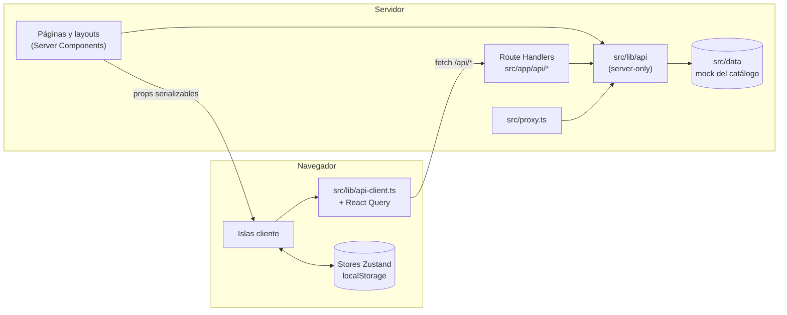

# Arquitectura del frontend

Cómo está organizado el frontend en la rama `feat/ui-overhaul`: carpetas, qué
corre en el servidor y qué en el navegador, cómo viajan los datos y dónde vive
el estado.

> **Backend: próximamente.** Hoy el catálogo es un mock local (`src/data`) y el
> checkout simula el pago. El diseño del backend está en
> [`docs/superpowers/specs/2026-10-17-backend-completo-design.md`](./superpowers/specs/2026-10-17-backend-completo-design.md).

## Estructura de carpetas

```
src/
  app/                      Rutas (App Router). Las páginas son Server Components.
    layout.tsx              Layout raíz: fuente, metadata, script de tema, providers, Navbar/Footer
    template.tsx            Envuelve cada página en <PageTransition> (transición de entrada)
    page.tsx                Inicio
    search/                 /search (catálogo completo o resultados de ?q=), con loading.tsx
    category/[categoryId]/  /category/:id (prerenderizada por categoría)
    item/[productId]/       /item/:id, ficha de producto (prerenderizada por producto)
    cart/ wishlist/ compare/  Carrito, favoritos y comparador (islas cliente)
    checkout/               /checkout; _components/ tiene pasos, stepper, resumen y confirmación
    (info)/                 Grupo de rutas con layout y menú lateral propios:
                            faq, envios, devoluciones, contacto, nosotros, terminos, privacidad
    api/                    Route Handlers que consumen las islas cliente:
      products/route.ts         GET /api/products (filtros, orden, paginación)
      products/by-ids/route.ts  GET /api/products/by-ids?ids=1,2
      products/facets/route.ts  GET /api/products/facets (conteos de filtros)
      search/route.ts           GET /api/search?q=&limit= (autocompletado)
    not-found.tsx error.tsx global-error.tsx
    manifest.ts opengraph-image.tsx apple-icon.tsx favicon.ico
    globals.css             Tokens de diseño y estilos base (ver design-system.md)
  proxy.ts                  404 reales para /category/* e /item/* desconocidos
  components/
    ui/                     Primitivos del sistema de diseño (barrel index.ts)
    layout/                 Navbar, NavbarActions, Footer, PageHeader, menús móviles,
                            ClientProviders, ThemeSync, PageTransition
    product/                Tarjeta, grilla, CatalogView y filtros, ficha, galería,
                            CompareBar, QuickViewModal, reseñas (reviews/)
    cart/ wishlist/ compare/ search/ home/ info/ forms/ icons/
    motion/Reveal.tsx       Stagger / StaggerItem / Reveal para usar desde Server Components
  config/                   site.ts (identidad, SEO, contacto, comercio) y navigation.ts
  data/                     Mock del catálogo (products.ts, categories.ts); solo lo lee src/lib/api
  hooks/                    useProductActions, useProductsByIds, useCatalogQuery,
                            useProductPages, useFacetCounts, useInfiniteScroll, …
  lib/
    api/                    Gateway de datos (server-only): index.ts, products.ts, search.ts
    api-client.ts           fetch del navegador a /api/*
    productQuery.ts         ProductQuery <-> search params de la URL
    pricing.ts              Subtotal, envío y totales (carrito, checkout, páginas de info)
    motion.ts               Presets de animación (ver design-system.md)
    motion-features.ts      Features de motion cargadas aparte por LazyMotion
    theme.ts                Script de tema previo al pintado, applyTheme, resolveDark
    metadata.ts             pageMetadata() y la imagen OG por defecto
    structuredData.ts       JSON-LD de producto
    card.ts argentina.ts    Tarjetas (marca, Luhn), provincias y códigos postales
    validations/            Esquemas zod y resolvers cargados bajo demanda
    compare.ts highlight.ts flyToCart.ts forms.ts utils.ts og/
  providers/                QueryProvider (React Query) y CategoriesProvider
  stores/                   Zustand: cart, wishlist, compare, recentlyViewed, theme,
                            review, checkout, ui; hydration.ts y persist.ts
  types/index.ts            Tipos de dominio (única fuente)
```

## Server Components y Client Components

**Regla:** las páginas y los layouts son Server Components. Leen datos con
`@/lib/api` y pasan a las islas solo props serializables. `"use client"` va en el
componente más chico que necesita estado, efectos, eventos o APIs del navegador.

Server Components (sin `"use client"`): todas las `page.tsx` y `layout.tsx`,
`Navbar`, `Footer`, `PageHeader`, las secciones de `components/home` (salvo
`HeroArt`), `components/info`, `RecommendedProducts`, `CatalogSkeleton` y los
primitivos sin interacción (`Badge`, `Breadcrumbs`, `Card`, `EmptyState`, `Price`,
`Skeleton`, `Spinner`).

Islas cliente principales:

| Isla | Dónde | Por qué es cliente |
| --- | --- | --- |
| `ClientProviders` | layout raíz | `LazyMotion`, `MotionConfig`, `StoreHydrator`, `ThemeSync`, `CompareBar` |
| `NavbarActions` | Navbar | Contadores del carrito y favoritos, carrito lateral, menú y búsqueda móviles |
| `SearchAutocomplete` | Navbar, búsqueda móvil | Combobox con `/api/search` |
| `CatalogView` (+ `ProductFilters`, `ProductSort`, `ActiveFilters`, `PriceFilter`) | inicio, `/search`, `/category/*` | Filtros en la URL, infinite scroll, conteos en vivo |
| `ProductGrid` / `ProductCard` | grillas | Acciones (carrito, favoritos, comparar), vista rápida |
| `ProductGallery`, `ProductPurchase`, `ProductDetailsTabs`, `ReviewsLink`, `RecentlyViewed` | ficha | Galería, compra, pestañas con reseñas, vistos recientemente |
| `CartView`, `WishlistView`, `CompareView` | `/cart`, `/wishlist`, `/compare` | Leen stores persistidos en `localStorage` |
| `CheckoutFlow` | `/checkout` | Wizard de pasos con estado en memoria |
| `ContactForm`, `NewsletterForm` | contacto, footer | React Hook Form |
| `Stagger`, `StaggerItem`, `Reveal` | cualquier Server Component | Animaciones de entrada |

Lo poco usado se carga con `next/dynamic` (`ssr: false`):

- Se precargan al pasar el puntero o enfocar su botón: `CartDrawer`, `MobileMenu`,
  `MobileSearch` (en `NavbarActions`), `QuickViewModal` (en `ProductGrid`) y
  `ReviewForm` (en `ProductReviews`).
- Se cargan después de hidratar: `ProductReviews` (en `ProductDetailsTabs`) y
  Sonner (`Toaster` en `src/components/ui/Toast.tsx`).
- Las devtools de React Query solo existen en desarrollo.

## Flujo de datos



- **`src/lib/api` es el único gateway de datos.** Empieza con
  `import "server-only"`, así que importarlo desde un Client Component rompe el
  build. Exporta funciones `async` con argumentos y resultados serializables
  (`null` para "no existe"): `getProducts`, `getProductById`, `getProductsByIds`,
  `searchProducts`, `getSearchSuggestions`, `getPaginatedProducts`,
  `getRelatedProducts`, `getFilterOptions`, `getFacetCounts`,
  `getFeaturedProducts`, `getSaleProducts`, `getCategories`, `getCategoryById`. El
  backend reemplazará los cuerpos sin cambiar las firmas.
- **Nadie más importa `@/data`.** La regla `no-restricted-imports` de
  `eslint.config.mjs` lo marca como error fuera de `src/lib/api/**` y
  `src/data/**`.
- **Las islas cliente usan los Route Handlers** a través de `@/lib/api-client`
  (`fetchProductsPage`, `fetchFacetCounts`, `fetchSearchSuggestions`,
  `fetchProductsByIds`), casi siempre con React Query. El catálogo nunca viaja en
  el bundle del cliente.
- **Una sola búsqueda** (`src/lib/api/search.ts`): todos los términos tienen que
  aparecer en nombre, tema, categoría o descripción, sin distinguir mayúsculas ni
  acentos. La usan `/search`, `/api/products?q=` y `/api/search`.
- **`ProductQuery` significa lo mismo en todos lados**: `parseProductQuery` y
  `serializeProductQuery` (`src/lib/productQuery.ts`) los usan las páginas, los
  Route Handlers y `api-client`.
- **React Query** (`src/providers/QueryProvider.tsx`): `staleTime` de 5 min,
  `gcTime` de 30 min, sin refetch al enfocar la ventana, 1 reintento. La primera
  página que renderizó el servidor siembra la caché (`useProductPages`,
  `useFacetCounts`), así que al cargar no se hace ningún fetch.
- **Precios**: `src/lib/pricing.ts` (`quoteShipping`, `linesSubtotal`,
  `orderTotals`, `SHIPPING_COST`, `FREE_SHIPPING_FROM`) es la única regla de envío y
  totales para carrito lateral, `/cart`, checkout y páginas de información.
  `siteConfig.commerce` reexporta esos valores.

## Estado del cliente

### Stores de Zustand (`src/stores`)

| Store | Clave de `localStorage` | Qué guarda |
| --- | --- | --- |
| `cartStore` | `lego-cart-storage` | Líneas del carrito (snapshot mínimo del producto + cantidad) |
| `wishlistStore` | `lego-wishlist-storage` | Favoritos (snapshot: id, nombre, precio, imagen, stock) |
| `compareStore` | `lego-compare-storage` | Solo IDs, máximo `MAX_COMPARE_ITEMS` (4) |
| `recentlyViewedStore` | `lego-recently-viewed` | Solo IDs, máximo `MAX_RECENTLY_VIEWED` (10), el más reciente primero |
| `themeStore` | `lego-theme-storage` (`THEME_STORAGE_KEY`) | `light` / `dark` / `system` |
| `reviewStore` | `lego-reviews-storage` | Reseñas (mock del lado del cliente hasta que llegue el backend) |
| `checkoutStore` | (no se persiste) | Paso actual, datos de envío, resumen del pago, pedido |
| `uiStore` | (no se persiste) | Carrito lateral abierto/cerrado (`openCartDrawer`) |

- Los componentes leen con **selectores** exportados por `@/stores`
  (`useCartCount`, `useCartSubtotal`, `useIsInCart(id)`, `useIsInWishlist(id)`,
  `useCompareIds`, `useRecentlyViewedIds`…), no con el store entero.
- **IDs en vez de productos**: comparar y vistos recientemente guardan IDs y piden
  datos frescos con `useProductsByIds` (`GET /api/products/by-ids`). Los IDs que la
  API ya no devuelve se quitan del store (`onMissing` → `removeMany`).
- **Persistencia versionada**: cada store persistido declara `version: 1`,
  `partialize` (solo los datos, nunca las acciones) y `migrate`, que sanea
  formatos anteriores (por ejemplo, `idsFrom` en `persist.ts` acepta arrays de
  strings o de objetos con `id`).
- **Deshacer**: carrito, favoritos y comparador tienen `restoreItem`; la posición
  se recuerda con `positionIn` / `RestorePosition` (`restorePosition.ts`).
- **El checkout no guarda la tarjeta**: `checkoutStore` vive en memoria y
  `setPaymentInfo` conserva solo un resumen (últimos 4 dígitos, nombre,
  vencimiento); el número y el CVV quedan en el formulario del paso.

### Hidratación: `StoreHydrator`

Los stores persistidos se crean con `skipHydration: true`, así el render del
servidor y el primer render del cliente ven los valores por defecto y coinciden.
`<StoreHydrator />` (`src/stores/hydration.ts`, montado en `ClientProviders`) lee
`localStorage` una vez después de hidratar, para todos los stores a la vez, y
escucha el evento `storage` para sincronizar pestañas. Donde importa distinguir
"cargando" de "vacío" (carrito, checkout) se usa `useStoresHydrated()` o
`useStoreHydrated(store)`.

### Tema sin parpadeo

El store de tema es la única fuente de verdad. `THEME_SCRIPT`
(`src/lib/theme.ts`) se inyecta inline en el `<head>` del layout raíz: lee
`lego-theme-storage` y aplica la clase `dark` y `color-scheme` antes del primer
pintado. Después, `ThemeSync` vuelve a aplicar el tema cuando el store se hidrata,
cuando cambia y cuando cambia la preferencia del sistema (modo `system`). Ambos
usan la misma regla, `resolveDark`.

### `useProductActions`

`useProductActions(product)` (`src/hooks/useProductActions.ts`) reúne las acciones
de producto para todas las entradas (tarjeta, ficha, vista rápida, favoritos):
devuelve `inCart`, `inWishlist`, `inCompare`, `isAvailable`, `addToCart`,
`removeFromCart`, `toggleWishlist` y `toggleCompare`, y dispara siempre los mismos
toasts (`productActionCopy`).

## Rutas y filtros en la URL

- `/search` sin `q` es el catálogo completo; con `?q=` muestra resultados. Ambas
  aceptan filtros y orden.
- `/category/[categoryId]` toma la categoría del path (`scope`), así que un
  `?category=` suelto se ignora.
- Claves de la URL (`src/lib/productQuery.ts`): `q`, `category`, `sort`, listas
  `theme`, `type`, `age`, `interest`, `pieces`, `highlight` (repetidas o separadas
  por comas), números `minPrice`, `maxPrice`, `minRating`, booleanos `inStock`,
  `onSale`, `isNew` (`1` o `true`). `page` y `limit` existen para la API, pero
  nunca se escriben en la URL de la página (infinite scroll).
- `useCatalogQuery` lee `window.location` (no `useSearchParams`) y escribe con
  `history.pushState`: la URL es compartible, Atrás/Adelante recorren los estados
  de filtros y la página puede seguir siendo estática, porque en el servidor y
  durante la hidratación usa `initialQuery`.
- `src/proxy.ts` (el "middleware" de Next 16) responde 404 real para categorías y
  productos desconocidos antes de renderizar.
- `/checkout` sin carrito redirige a `/cart` (en `CheckoutFlow`).

## SEO

- **Metadata**: el layout raíz define `metadataBase` (`siteConfig.url`, que sale de
  `NEXT_PUBLIC_SITE_URL` o `http://localhost:3000`), plantilla de título, Open
  Graph y Twitter. Las páginas usan `pageMetadata()` (`src/lib/metadata.ts`), que
  agrega canonical y rearma `openGraph` (Next lo mezcla de forma superficial).
  Ficha y categoría usan `generateMetadata`.
- **`noindex`**: `/cart`, `/wishlist`, `/compare`, `/search` (index false, follow
  true) y `/checkout` (index y follow false).
- **JSON-LD**: `Product` en la ficha (`productJsonLd` + `serializeJsonLd`, que
  escapa `<`) y `FAQPage` en `/faq`. Las valoraciones quedan fuera a propósito: las
  reseñas son mock.
- **Imágenes sociales**: `src/app/opengraph-image.tsx` (tarjeta por defecto,
  1200×630) y la primera foto real del producto en cada ficha. También
  `apple-icon.tsx` y `manifest.ts`.
- **No hay `sitemap.ts` ni `robots.ts`** en esta rama.

## Caché y generación estática

- Inicio, fichas (`generateStaticParams` sobre `getProducts`), categorías
  (`generateStaticParams` sobre `getCategories`) y páginas de información se
  prerenderizan en el build.
- Estas rutas no tienen `loading.tsx`: el HTML estático trae el contenido en orden.
  Solo `/search` tiene `loading.tsx`, porque depende de `searchParams` y se renderiza
  por pedido.
- Los Route Handlers leen los search params de cada request, así que responden
  por pedido; la caché del lado del cliente es la de React Query.
- No hay `revalidate`, `unstable_cache` ni `"use cache"`: con datos mock no hace
  falta. Cuando llegue el backend, la estrategia de caché se define en su spec.
- Imágenes: `next/image` con AVIF y WebP de respaldo (`next.config.mjs`), y
  `remotePatterns` para `www.lego.com/cdn/**`.
- `next.config.mjs` acepta `NEXT_DIST_DIR` para compilar en otra carpeta (el
  proyecto `prod` de Playwright usa `.next-e2e` y así no pisa el `.next` de
  `next dev`).
