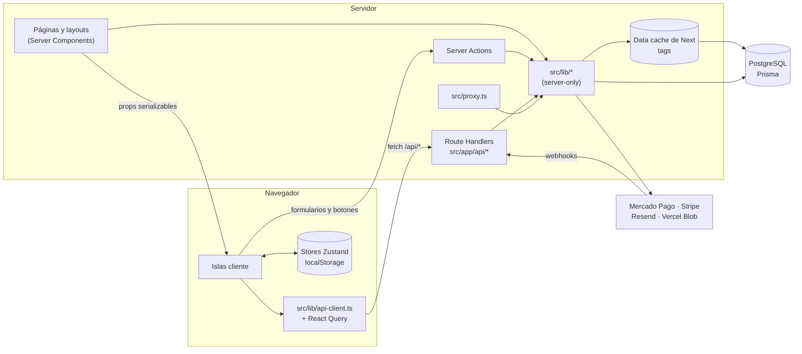

# Arquitectura

Cómo está organizada la app: carpetas, qué corre en el servidor y qué en el
navegador, cómo viajan los datos y dónde vive el estado. El lado del servidor
(Prisma, caché, sesión, rate limiting, emails, subidas, auditoría) está en
[backend.md](./backend.md); las tablas en [data-model.md](./data-model.md); los
pagos en [payments.md](./payments.md); el panel en [admin.md](./admin.md).

## Estructura de carpetas

```
prisma/
  schema.prisma             Modelo de datos (ver data-model.md)
  migrations/               Migraciones SQL (las restricciones CHECK y el trigger de cupones, a mano)
  seed.ts seed/             Seed idempotente (catálogo de src/data, reseñas, pedidos, cupones, admin)
prisma.config.ts            Config del CLI de Prisma (URL de la base, seed)
docker-compose.yml          Postgres 17 local (bases lego_store y lego_store_test)
vercel.json                 Cron de la limpieza de pedidos
src/
  app/                      Rutas (App Router). Las páginas son Server Components.
    layout.tsx              Layout raíz: fuente, metadata, script de tema, sesión, configuración, providers, Navbar/Footer
    template.tsx            Envuelve cada página en <PageTransition>
    page.tsx                Inicio
    search/                 /search (catálogo completo o resultados de ?q=), con loading.tsx
    category/[categoryId]/  /category/:id
    item/[productId]/       /item/:id, ficha de producto
    cart/ wishlist/ compare/  Carrito, favoritos y comparador (islas cliente)
    checkout/               /checkout; _components/ (pasos, Mercado Pago, Stripe, resumen, confirmación);
                            pedido/[orderId]/ (vuelta de Checkout Pro)
    (auth)/                 /login y /register + sus Server Actions
    account/                /account y /account/orders (Mis pedidos) + Server Actions
    admin/                  Panel de admin (solo ADMIN, ver admin.md)
    (info)/                 faq, envios, devoluciones, contacto, nosotros, terminos, privacidad
                            (contenido desde la base, layout con menú lateral)
    newsletter/             /newsletter/baja y /newsletter/confirmar (enlaces firmados)
    uploads/[file]/         Subidas locales escritas después de arrancar next start
    api/                    Route Handlers (ver backend.md)
    sitemap.ts robots.ts    /sitemap.xml y /robots.txt desde la base
    forbidden.tsx not-found.tsx error.tsx global-error.tsx
    manifest.ts opengraph-image.tsx apple-icon.tsx favicon.ico
    globals.css             Tokens de diseño y estilos base (ver design-system.md)
  proxy.ts                  /account y /admin sin sesión → /login; 404 reales y redirecciones de categorías
  instrumentation.ts        Avisos al arrancar (IP sin proxy confiable, pagos simulados)
  components/
    ui/                     Primitivos del sistema de diseño (barrel index.ts)
    layout/                 Navbar, Footer, barra de anuncio, menú de cuenta y de temas,
                            menús móviles, ListsSync, ClientProviders, ThemeSync, PageTransition
    product/                Tarjeta, grilla, CatalogView y filtros, ficha, galería, reseñas
    admin/                  Panel: navegación, tablas, formularios, galería, subidas, gráficos
    account/ auth/ orders/  Cuenta, login y registro, pedidos
    content/                Bloques de las páginas informativas (Markdown, FAQ, listas)
    cart/ wishlist/ compare/ search/ home/ info/ forms/ newsletter/ icons/
    motion/Reveal.tsx       Stagger / StaggerItem / Reveal para Server Components
  config/                   site.ts (identidad, SEO, plazos) y navigation.ts
  data/                     Fuente del seed (la app no lo lee: ESLint lo impide)
  generated/prisma/         Cliente de Prisma generado (gitignored)
  hooks/                    useProductActions, useProductsByIds, useCatalogQuery, useFocusAfterRemoval…
  lib/                      Lógica (ver backend.md, «Mapa de src/lib»); también api-client.ts,
                            productQuery.ts, pricing.ts, metadata.ts, structuredData.ts, theme.ts, motion.ts
  providers/                QueryProvider, CategoriesProvider, ShippingRulesProvider, ViewerProvider
  stores/                   Zustand: cart, wishlist, compare, recentlyViewed, coupon, theme, checkout, ui;
                            listsRemote.ts (cambios optimistas contra el servidor), hydration.ts, persist.ts
  types/index.ts            Tipos de dominio (única fuente)
```

## Server Components y Client Components

**Regla:** las páginas y los layouts son Server Components. Leen datos en el
servidor (`@/lib/api`, `@/lib/settings`, `@/lib/content`, la sesión) y pasan a las
islas solo props serializables. `"use client"` va en el componente más chico que
necesita estado, efectos, eventos o APIs del navegador.

Islas cliente principales:

| Isla | Dónde | Por qué es cliente |
| --- | --- | --- |
| `ClientProviders` | layout raíz | `LazyMotion`, `MotionConfig`, `StoreHydrator`, `ThemeSync`, `ListsSync`, `CompareBar` |
| `NavbarActions`, `AccountMenu` | Navbar | Contadores del carrito y favoritos, carrito lateral, menú de cuenta, menú y búsqueda móviles |
| `SearchAutocomplete` | Navbar, búsqueda móvil | Combobox con `/api/search` |
| `CatalogView` (+ filtros, orden, chips) | inicio, `/search`, `/category/*` | Filtros en la URL, infinite scroll, conteos en vivo |
| `ProductGrid` / `ProductCard` | grillas | Acciones (carrito, favoritos, comparar), vista rápida |
| `ProductGallery`, `ProductPurchase`, `ProductDetailsTabs`, `RecentlyViewed` | ficha | Galería, compra, reseñas, vistos recientemente |
| `CartView`, `WishlistView`, `CompareView` | `/cart`, `/wishlist`, `/compare` | Stores persistidos y, con sesión, el servidor |
| `CheckoutFlow` | `/checkout` | Pasos con estado en memoria; paso Pago cargado bajo demanda (Payment Brick o Payment Element) |
| `ContactForm`, `NewsletterForm` | contacto, footer | React Hook Form + Server Actions |
| Formularios y tablas interactivas del admin | `/admin/*` | `useActionState`, confirmaciones, subidas con progreso |

Lo poco usado se carga con `next/dynamic` (carrito lateral, menús móviles, vista
rápida, formulario de reseñas, el paso Pago) y se precarga al pasar el puntero o
enfocar su botón; Sonner y las reseñas de la ficha se cargan después de hidratar.

## Flujo de datos



- **`src/lib/api` es el gateway de lecturas del catálogo** (`server-only`):
  funciones `async` con argumentos y resultados serializables (`null` para "no
  existe"): `getProducts`, `getProductById`, `getProductsByIds`,
  `searchProducts`, `getSearchSuggestions`, `getPaginatedProducts`,
  `getRelatedProducts`, `getFilterOptions`, `getFacetCounts`,
  `getFeaturedProducts`, `getHomePicks`, `getSaleProducts`, `getCategories`,
  `getCategoryById`, `getThemes`, `getReviewPage`, `getSitemapSource`… Consultas
  Prisma detrás del data cache con tags (ver
  [backend.md](./backend.md#caché-y-tags)).
- **`src/data` es solo la fuente del seed**: importarlo desde `src/` es un error de
  ESLint.
- **Las islas cliente leen por Route Handlers** a través de `@/lib/api-client`
  (`fetchProductsPage`, `fetchFacetCounts`, `fetchSearchSuggestions`,
  `fetchProductsByIds`…), casi siempre con React Query (`staleTime` 5 min, `gcTime`
  30 min, sin refetch al enfocar). La primera página que renderizó el servidor
  siembra la caché. El catálogo nunca viaja en el bundle.
- **Las escrituras de la UI son Server Actions** (carrito y favoritos, reseñas,
  cuenta, contacto, newsletter, admin); el checkout usa Route Handlers porque
  necesita códigos de estado y cookies propias.
- **Una sola búsqueda** (`src/lib/api/search.ts`): todos los términos tienen que
  aparecer en nombre, tema, categoría o descripción, sin distinguir mayúsculas ni
  acentos, sobre la columna normalizada `Product.searchText`.
- **Precios**: `src/lib/pricing.ts` (`orderTotals`, `quoteShipping`…) es la única
  cuenta de subtotal, descuento, envío y total. La regla de envío viene de la
  configuración de la tienda: el carrito la recibe del layout
  (`ShippingRulesProvider`) y el servidor la lee de la base al preparar cada
  pedido.

## Estado del cliente

| Store | Clave de `localStorage` | Qué guarda |
| --- | --- | --- |
| `cartStore` | `lego-cart-storage` | Líneas del carrito y de quién es la copia (`owner`) |
| `wishlistStore` | `lego-wishlist-storage` | Favoritos (snapshot mínimo) y `owner` |
| `compareStore` | `lego-compare-storage` | Solo ids, máximo 4 |
| `recentlyViewedStore` | `lego-recently-viewed` | Solo ids, máximo 10 |
| `couponStore` | `lego-coupon-storage` | Los términos del cupón aplicado y su dueño (siempre se vuelven a consultar al servidor) |
| `themeStore` | `lego-theme-storage` | `light` / `dark` / `system` |
| `checkoutStore` | (no se persiste) | Paso actual, envío, resumen del medio de pago, pedido |
| `uiStore` | (no se persiste) | Carrito lateral abierto/cerrado |

- **Visitantes**: carrito y favoritos viven en `localStorage`; al cargar, las líneas
  toman precio y stock actuales de `/api/products/by-ids`.
- **Con sesión el servidor es la verdad** (`CartItem`, `WishlistItem`).
  `ListsSync` fusiona las listas del visitante con las de la cuenta al ingresar
  (una vez, idempotente con un token), recarga las de la cuenta en cada carga y al
  volver a la pestaña (`GET /api/lists`) y borra la copia de la cuenta al cerrar
  sesión. Los cambios son optimistas (`listsRemote.ts`): la respuesta del servidor
  reemplaza la línea local y, si la rechaza, vuelve atrás con un toast.
- Los componentes leen con **selectores** (`useCartCount`, `useIsInCart(id)`…).
  Cada store persistido declara `version`, `partialize` y `migrate`.
- **Hidratación**: los stores usan `skipHydration` y `<StoreHydrator />` los carga
  una sola vez tras hidratar (y sincroniza pestañas). `useStoresHydrated()`
  distingue "cargando" de "vacío".
- **Tema sin parpadeo**: un script inline en `<head>` aplica la clase `dark` antes
  del primer pintado y `ThemeSync` lo mantiene al día.
- **El checkout no guarda datos de tarjeta**: solo lo que devolvió el medio de pago
  para mostrar (marca, últimos 4, cuotas) y, en memoria, el token o el `formData`
  del Brick hasta "Realizar pedido".
- **Sesión en el cliente**: el layout lee la sesión en el servidor y la pasa a
  `ViewerProvider`; el navbar llega con el menú de cuenta ya resuelto.

## Rutas y filtros en la URL

- `/search` sin `q` es el catálogo completo; con `?q=` muestra resultados.
- `/category/[categoryId]` toma la categoría del path; un slug viejo redirige
  (308) al actual, con sus filtros.
- Claves de la URL (`src/lib/productQuery.ts`): `q`, `category`, `sort`, listas
  `theme` (slug, o el nombre en enlaces viejos), `type`, `age`, `interest`,
  `pieces`, `highlight`, números `minPrice`, `maxPrice`, `minRating`, booleanos
  `inStock`, `onSale`, `isNew`. `page` y `limit` existen para la API, nunca en la
  URL de la página (infinite scroll).
- `src/proxy.ts` responde 404 real para categorías y productos desconocidos (o
  archivados) antes de renderizar, y manda a `/login` a quien pide `/account/*` o
  `/admin/*` sin sesión.
- `/checkout` sin carrito redirige a `/cart`.

## SEO

- **Metadata**: el layout raíz define `metadataBase` (`siteConfig.url`, de
  `NEXT_PUBLIC_SITE_URL`), plantilla de título, Open Graph y Twitter.
  `pageMetadata()` agrega canonical. Ficha, categoría y páginas informativas usan
  `generateMetadata`.
- **`noindex`**: `/cart`, `/wishlist`, `/compare`, `/search`, `/login`,
  `/register` (index false, follow true); `/checkout`, `/checkout/pedido/*`,
  `/account/*`, `/admin/*` y `/newsletter/*` (index y follow false).
- **`/sitemap.xml`** (`src/app/sitemap.ts`): inicio, categorías visibles,
  productos a la venta y páginas informativas publicadas, desde la base, con su
  última modificación; se regenera cuando un admin cambia algo de eso (tags) y al
  menos cada hora. **`/robots.txt`** (`src/app/robots.ts`): permite la tienda,
  excluye `/admin`, `/account`, `/checkout`, `/newsletter/` y `/api/`, y apunta al
  sitemap. Reglas en `src/lib/sitemap.ts`.
- **JSON-LD**: `Product` en la ficha (`serializeJsonLd` escapa `<`) y `FAQPage` en
  `/faq`, armado con los grupos de preguntas del contenido publicado.
- **Imágenes sociales**: `opengraph-image.tsx` (tarjeta por defecto) y la primera
  foto del producto en cada ficha.

## Renderizado y caché

- Las páginas se renderizan **por pedido**: el layout lee la sesión para mostrar
  el navbar sin parpadeo. Las lecturas compartidas salen del data cache con tags
  (catálogo, configuración, contenido), así que el costo por pedido es el render
  más una consulta de usuario cuando hay sesión. Volver a servir HTML estático
  pediría Cache Components (PPR), un cambio de modelo de caché pendiente.
- Ficha y categoría declaran `generateStaticParams` (el build lee la base), pero
  igual se renderizan por pedido por la sesión del layout.
- Solo `/search` tiene `loading.tsx`.
- Imágenes: `next/image` con AVIF y WebP; `remotePatterns` para
  `www.lego.com/cdn/**` y `*.public.blob.vercel-storage.com` (subidas).
- `next.config.mjs` acepta `NEXT_DIST_DIR` (el proyecto `prod` de Playwright
  compila en `.next-e2e`) y define los headers de seguridad (anti-framing, CSP
  `frame-ancestors 'none'; object-src 'none'; base-uri 'self'`, `nosniff`,
  `Referrer-Policy`, HSTS en producción).
