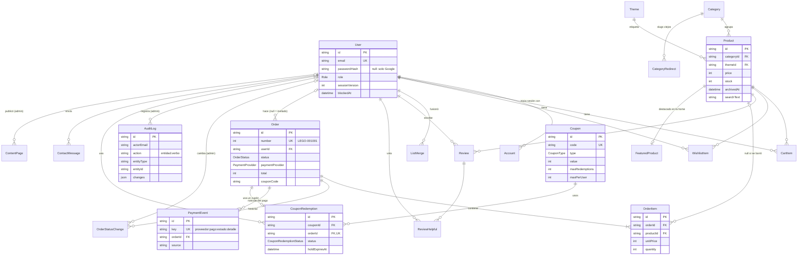
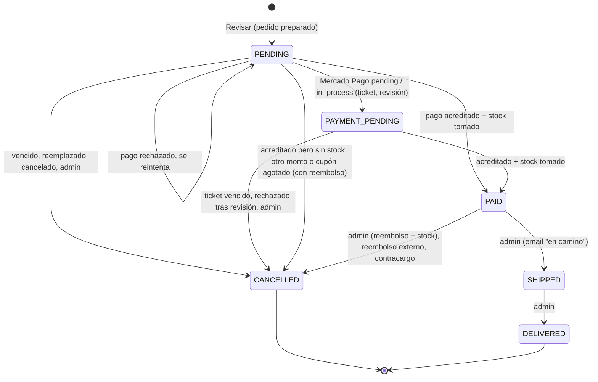
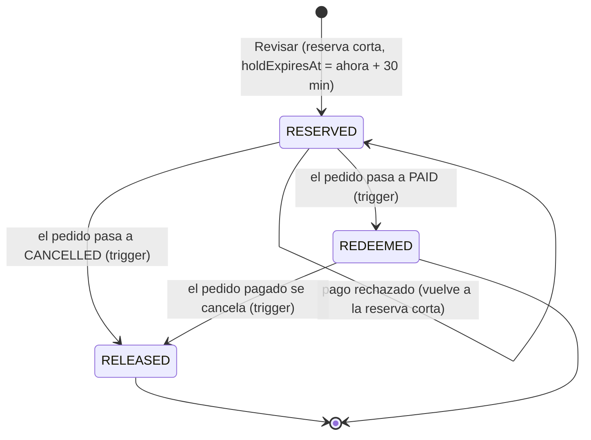
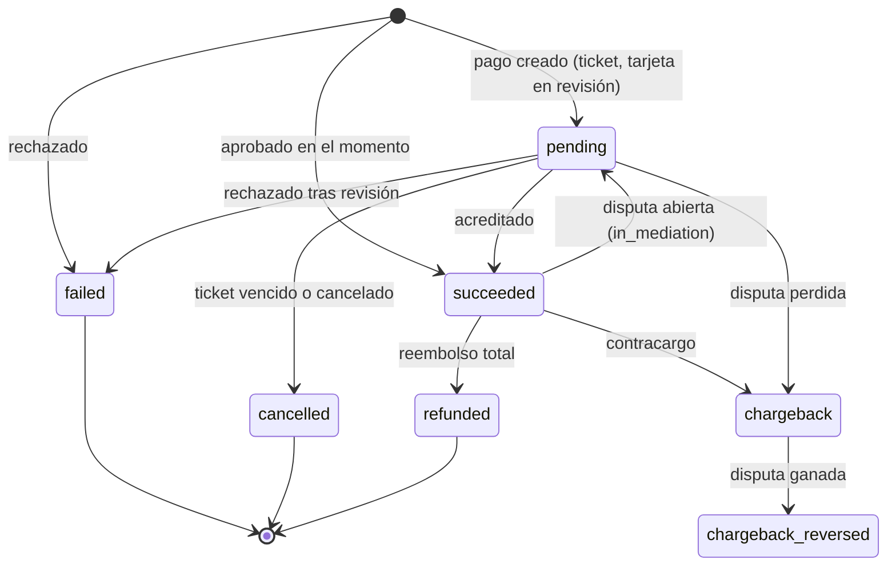

# Modelo de datos

Qué guarda la base (PostgreSQL 17, Prisma 7), para qué sirve cada tabla, qué
reglas cumple y cómo cambian de estado los pedidos, los usos de cupones y los
pagos. La fuente de verdad es [`prisma/schema.prisma`](../prisma/schema.prisma)
(con un comentario por campo) y las migraciones de
[`prisma/migrations`](../prisma/migrations); esto es el mapa.

## Convenciones

- **Plata en pesos enteros (ARS)**, como los precios de la UI: `price`,
  `subtotal`, `discount`, `shipping`, `total`, `value` de un cupón… Stripe recibe
  centavos (`× 100`, `toCentavos` en `src/lib/payments/gateway.ts`); Mercado Pago
  recibe importes decimales en pesos, que para estos precios son los mismos
  enteros.
- **Emails en minúsculas**: la app los normaliza antes de cada escritura y
  búsqueda (`normalizeEmail()`) y la base lo exige con `CHECK` en `User`,
  `Order`, `CouponRedemption`, `OrderStatusChange` y `AuditLog`.
- **Restricciones `CHECK` escritas a mano**: el lenguaje de Prisma no tiene
  sintaxis para ellas, así que van al final de las migraciones (sección
  "Hand-written"). Si una migración nueva recrea una tabla, copia las suyas
  (ver [CONTRIBUTING.md](../CONTRIBUTING.md#base-de-datos-y-migraciones)).
- **Ids**: `cuid()` salvo excepciones con sentido: `Category.id` es el slug de
  la URL, los productos del seed conservan sus ids históricos (`"1"`…`"22"`,
  así `/item/1` sigue andando), `StoreSettings.id` es siempre `1` y
  `ContentPage.slug` es la ruta de la página.
- **Snapshots**: lo que un pedido mostró al comprar (líneas, precios, nombre,
  imagen, dirección, código de cupón, descuento) se copia en el pedido. Editar o
  borrar el producto o el cupón no cambia pedidos existentes.

## Diagrama

Las relaciones principales (sin las tablas de Auth.js que no se usan con JWT ni
las que no se relacionan con nada).

## Tablas

### Usuarios y autenticación

| Modelo | Para qué | Campos y reglas clave |
| --- | --- | --- |
| `User` | Una cuenta (cliente o admin). | `email` único y en minúsculas; `passwordHash` (bcrypt, `null` para cuentas solo de Google); `role` `USER` / `ADMIN`; `sessionVersion ≥ 0` (sube al cambiar la contraseña, al cerrar sesión en todos los dispositivos, en el logout de un admin y al bloquear: los JWT con otra versión dejan de valer); `blockedAt` / `blockedReason` (bloqueo del admin). |
| `Account` | Vínculo con un proveedor OAuth (Google), forma del adapter de Auth.js. | PK `(provider, providerAccountId)`; se borra con el usuario. |
| `Session`, `VerificationToken` | Tablas que el adapter de Auth.js espera. | Quedan vacías: las sesiones son JWT y no hay login por email. |

### Catálogo

| Modelo | Para qué | Campos y reglas clave |
| --- | --- | --- |
| `Category` | Categoría de la navegación y su página `/category/<id>`. | `id` = slug (editable: los productos lo siguen con `ON UPDATE CASCADE`); `position` (orden); `visible` (oculta: fuera de navegación, home y filtros, su página da 404; sus productos se siguen vendiendo); `image` + `imageAlt`. |
| `CategoryRedirect` | Slug viejo de una categoría renombrada. | PK `slug`; `proxy.ts` responde 308 al slug actual. Otra categoría no puede tomar un slug viejo. |
| `Theme` | Tema de producto ("Star Wars"): etiqueta de las tarjetas, menú "Temas" y filtro. | `slug` y `name` únicos (el nombre, además, sin distinguir mayúsculas ni acentos: lo controla la app); `position`; `visible`. |
| `Product` | Un set. | `price > 0`; `originalPrice` existe exactamente cuando `isOnSale` y es mayor que `price`; `stock ≥ 0`; `rating` (0–5, una decimal) y `reviewCount` son columnas cacheadas de las reseñas (`rating = 0` si y solo si `reviewCount = 0`); `searchText` / `searchName` (texto normalizado para la búsqueda, lo recalcula la app en cada escritura); `archivedAt` (archivado: fuera de toda lectura de la tienda, pero sigue en la base por los pedidos); `images` + `imageAlts` en el mismo orden; `categoryId` y `themeId` con `onDelete: Restrict`. |
| `FeaturedProduct` | Los "Destacados" de la home, en orden. | PK `productId`; `position ≥ 0`. |

### Listas del usuario

| Modelo | Para qué | Campos y reglas clave |
| --- | --- | --- |
| `CartItem` | Una línea del carrito de una cuenta. | Único `(userId, productId)`; `quantity > 0`, topeada por el stock en cada escritura. Los visitantes guardan el suyo en `localStorage`. |
| `WishlistItem` | Un favorito de una cuenta. | PK `(userId, productId)`. |
| `ListMerge` | Fusiones de listas de visitante ya aplicadas al ingresar. | PK `(userId, token)`: un reintento con el mismo token no suma dos veces (`src/lib/lists/merge.ts`). |

### Reseñas

| Modelo | Para qué | Campos y reglas clave |
| --- | --- | --- |
| `Review` | Una reseña. | Única `(userId, productId)`: una por usuario y producto; `rating` 1–5. Cada escritura recalcula `Product.rating` y `reviewCount` en la misma transacción. |
| `ReviewHelpful` | Un voto "útil". | PK `(userId, reviewId)`: un voto por usuario. |

### Pedidos y pagos

| Modelo | Para qué | Campos y reglas clave |
| --- | --- | --- |
| `Order` | Un pedido, desde "Revisar". | `number` autoincremental desde 1001 (`LEGO-001001`); `userId` `null` para invitados (nunca se vincula a una cuenta creada después); dirección y montos como snapshot; `total = subtotal − discount + shipping`, `0 ≤ discount ≤ subtotal` y `discount > 0` solo con `couponCode` (`CHECK`); `paymentProvider` (`STRIPE` / `MERCADOPAGO`, lo conserva toda su vida); Stripe usa `stripePaymentIntentId` / `stripeRefundId` (únicos), Mercado Pago `providerPaymentId` (único junto al proveedor) / `providerRefundId`, `providerCheckoutId` / `providerCheckoutUrl` (preferencia de Checkout Pro), `paymentStatus` / `paymentStatusDetail` (el estado propio del proveedor), `paymentMethodType`, `installments > 0`, `ticketUrl` / `ticketExpiresAt` (efectivo); `paymentBrand` / `paymentLast4` (lo que se muestra, nunca datos de tarjeta); `checkoutTokenHash` (sha256 del token de la cookie que deja a un invitado ver y pagar su pedido); `refundRequestedAt` (un admin pidió el reembolso y el resultado no se sabe todavía: no se puede enviar); `submittedAt` (primer "Realizar pedido": sin él es un checkout abandonado) y las fechas de cada estado; `cancelReason` (ver abajo). |
| `OrderItem` | Una línea del pedido. | Snapshot de `name`, `unitPrice ≥ 0`, `image`; `quantity > 0`; `productId` pasa a `null` si el producto se borra. Única `(orderId, productId)`. |
| `OrderStatusChange` | Los cambios de estado que hizo un admin (la línea de tiempo del pedido). | `fromStatus ≠ toStatus`; `actorEmail` (se conserva si se borra la cuenta); `refundId` cuando el cambio reembolsó. Los cambios de webhooks y de la limpieza no van acá: sus fechas están en el pedido. |
| `PaymentEvent` | Lo que Mercado Pago dijo de los pagos de un pedido, en orden. | `key` único `MERCADOPAGO:<pago>:<estado>:<detalle>`: la misma noticia se aplica una sola vez; `source` = `checkout`, `webhook`, `return`, `expire` o `admin`. Es a la vez el historial que ve el admin y el registro de idempotencia. |
| `ProcessedStripeEvent` | Eventos de webhook de Stripe ya procesados. | PK = id del evento; se escribe en la misma transacción que sus cambios. |

Motivos de cancelación (`Order.cancelReason`, `CancelReason` en
`src/lib/orders/types.ts`; los textos del cliente están en
`src/lib/orders/format.ts` y los del admin en `src/lib/admin/format.ts`):

| Motivo | Cuándo |
| --- | --- |
| `out_of_stock` | El pago se acreditó pero a una línea le faltaba stock: se reembolsa. |
| `amount_mismatch` | Lo cobrado no es el total del pedido: se reembolsa (el resumen del admin avisa). |
| `payment_canceled` | El pago se canceló (Stripe `payment_intent.canceled`, un pago de Mercado Pago cancelado). |
| `expired` | La limpieza diaria lo dio por abandonado, o venció el ticket. |
| `superseded` | Un pedido nuevo del mismo navegador lo reemplazó. |
| `payment_setup_failed` | No se pudo crear el PaymentIntent de Stripe. |
| `refunded` | Se reembolsó desde el proveedor (dashboard de Stripe, panel de Mercado Pago). |
| `late_payment_refunded` | Mercado Pago acreditó un pago de un pedido ya cancelado: se reembolsa. |
| `payment_rejected` | Mercado Pago rechazó un pago que estaba en revisión. |
| `chargeback` | Contracargo (`charged_back`). |
| `coupon_unavailable` | Un pago de Checkout Pro llegó cuando su cupón ya no entraba: se reembolsa o se cancela el pago pendiente. |
| `admin` | Lo canceló un admin (con reembolso si estaba pagado). |

### Cupones

| Modelo | Para qué | Campos y reglas clave |
| --- | --- | --- |
| `Coupon` | Un código de descuento. | `code` único, en mayúsculas, `^[A-Z0-9_-]{3,32}$` (`CHECK`; no se edita ni se borra); `type` `PERCENT` (1–100) o `FIXED` (pesos, > 0); `minSubtotal ≥ 0`; `startsAt` / `expiresAt` (`expiresAt > startsAt`); `maxRedemptions` y `maxPerUser` (> 0 o `null` = sin límite); `active`; `appliesTo` `ALL` (único alcance hoy). |
| `CouponRedemption` | Un uso de un cupón por un pedido (como mucho uno por pedido). | `orderId` único; `userId` (o el `email` para invitados) para el límite por cliente; `status` y `holdExpiresAt` (ver la máquina de estados); `discount` (snapshot). |

### Administración y tienda

| Modelo | Para qué | Campos y reglas clave |
| --- | --- | --- |
| `AuditLog` | Quién hizo qué, cuándo y desde dónde, para toda mutación del admin. | `action` `<entidad>.<verbo>` (`product.update`, `order.cancel`, `export.orders`…); `entityType` + `entityId`; `changes` = `{campo: [antes, después]}` o lo guardado al crear/borrar; `ip` solo si `client-ip.ts` la confía. Ver [admin.md](./admin.md#auditoría). |
| `StoreSettings` | La configuración de la tienda: una sola fila. | `id = 1` (`CHECK`); `shippingCost > 0` y `freeShippingFrom > 0` (para envío gratis siempre, umbral $1); barra de anuncio (texto, enlace, `announcementTone`: un par de tokens, nunca un color); contacto y redes. Sin la fila, la app usa `DEFAULT_STORE_SETTINGS`. |
| `ContentPage` | El contenido de una página informativa (`/faq`, `/envios`…). | PK `slug`; `draft` y `published` (JSON validado con zod al escribir y al leer: una fila inválida es "sin contenido", 404); `publishedAt`, `publishedBy*`, `draftByEmail`. |
| `ContactMessage` | Un mensaje del formulario de `/contacto`. | `status` `NEW` → `READ` → `ARCHIVED`; `topic` (de `CONTACT_TOPICS`); `userId` si había sesión; `ip`. |
| `NewsletterSubscriber` | Una suscripción. | `email` único; `unsubscribedAt` (la baja conserva la fila); `resubscribeTokenHash` / `resubscribeRequestedAt` (confirmación para volver a suscribirse). El enlace de baja no se guarda: es el id firmado con `AUTH_SECRET`. |
| `RateLimit` | Contadores de rate limiting, compartidos por todas las instancias. | PK `key` `<limitador>:<sujeto>`; `count > 0`; `resetAt` (reloj de la base). Ver [backend.md](./backend.md#rate-limiting). |

## Máquinas de estado

### Pedido (`OrderStatus`)

Cada transición corre bajo el bloqueo de la fila del pedido (`SELECT … FOR
UPDATE`, `lockOrderRow`). `PAID` solo lo pone el proveedor (webhook, la respuesta
de Mercado Pago, la vuelta de Checkout Pro o la limpieza que encuentra un pago
acreditado); el admin solo envía, entrega y cancela
(`ADMIN_TRANSITIONS`, `src/lib/admin/format.ts`).

- Un pedido `SHIPPED` o `DELIVERED` no se cancela: un reembolso o contracargo
  que llega después solo queda anotado (estado del pago e historial).
- Un pago que llega para un pedido ya `CANCELLED` se reembolsa y el pedido sigue
  cancelado (`late_payment_refunded` con Mercado Pago).
- `PAID` con `refundRequestedAt` puesto es un pedido "retenido": un admin pidió el
  reembolso y el resultado no se confirmó; no se puede enviar hasta que se
  reintente la cancelación. Ver [admin.md](./admin.md#pedidos).

### Uso de un cupón (`CouponRedemptionStatus`)

Lo mueve un trigger de la base sobre `Order.status`
(`coupon_redemption_follows_order`, migraciones de cupones y de la reserva
corta), así que ningún camino de cancelación puede olvidarse de liberarlo.

- Los límites (`maxRedemptions`, `maxPerUser`) cuentan los `REDEEMED` más los
  `RESERVED` vigentes (`holdExpiresAt` `null` o en el futuro). Una reserva vencida
  no cuenta y, si el cliente paga igual, se valida como un uso nuevo.
- `PAYMENT_PENDING` deja la reserva sin vencimiento hasta que el pago se resuelva.
- Detalle de las reglas en [payments.md](./payments.md#cupones-en-los-totales).

### Pago (estados del proveedor → `NormalizedPaymentStatus`)

Cada proveedor traduce sus estados a un vocabulario común
(`src/lib/payments/provider.ts`); qué hace cada uno con el pedido lo decide el
flujo de ese proveedor según el estado del pedido (no hay una tabla fija).

| Mercado Pago (`status` / `status_detail`) | Stripe (evento) | Normalizado |
| --- | --- | --- |
| `approved` | `payment_intent.succeeded` | `succeeded` |
| `pending`, `in_process`, `authorized`, `in_mediation` | — | `pending` |
| `rejected` | `payment_intent.payment_failed` | `failed` |
| `cancelled` | `payment_intent.canceled` | `cancelled` |
| `refunded` | `charge.refunded` (total) | `refunded` |
| `charged_back` | — | `chargeback` |
| `charged_back` / `reimbursed` | — | `chargeback_reversed` |

`chargeback_reversed` solo se registra (estado del pago, historial y un aviso en
el log): el pedido ya se canceló con el contracargo y no se reembolsa. No hay una
acción del admin para volver a pagarlo.
