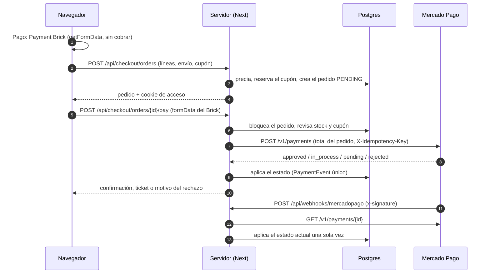

# Pagos

Cómo cobra la tienda: la capa de proveedores, el flujo con **Mercado Pago**
(el proveedor principal), **Stripe** como alternativa, cómo entran los cupones en
el total, el modo de prueba sin cuentas reales y cómo probar con credenciales de
prueba y webhooks en tu máquina. Las tablas y los estados están en
[data-model.md](./data-model.md); lo que hace el admin con un pedido pagado, en
[admin.md](./admin.md#pedidos).

Versiones instaladas: `mercadopago` 3.6 (SDK de Node), `@mercadopago/sdk-react`
1.0 (Payment Brick), `stripe` 23, `@stripe/react-stripe-js` 7 y
`@stripe/stripe-js` 10.

## Principios

- **El flujo visible es Envío → Pago → Revisar → confirmación**, y **solo
  "Realizar pedido" cobra**. El paso Pago solo *recolecta* el medio de pago.
- **El monto lo calcula el servidor**: "Revisar" precia las líneas desde la base,
  aplica el cupón y la regla de envío leída en la misma transacción, y guarda el
  pedido PENDING. Lo que se cobra es `Order.total`, nunca un monto del navegador.
- **Moneda ARS, montos en pesos enteros.** Mercado Pago recibe pesos
  (`transaction_amount`, importes decimales que acá son enteros); Stripe recibe
  centavos (`total × 100`).
- **Cada pedido conserva su proveedor** (`Order.paymentProvider`): sus
  cancelaciones y reembolsos van siempre al proveedor que lo cobró, aunque la
  tienda cambie de proveedor después.
- **Idempotencia en todo lo que mueve plata**: idempotency key por intento de
  pago y una sola por reembolso de pedido (`order/<id>/refund`, `orderRefundKey`),
  la pida el admin, un webhook o la limpieza.
- **Los webhooks se verifican y no se les cree el cuerpo**: Mercado Pago se
  consulta a la API; Stripe se verifica con la firma del evento.

## La capa `PaymentProvider`

`src/lib/payments/provider.ts` define lo que es común **después** de cobrar:

| Método | Qué hace |
| --- | --- |
| `cancelPayment(paymentId)` | Cancela un pago que no se acreditó; responde `in_flight` si ya pasó o no se puede frenar. |
| `refund(paymentId, { idempotencyKey, amount? })` | Reembolso total o parcial; la misma key devuelve el mismo reembolso. |
| `findRefund(paymentId)` | Un reembolso total que el pago ya tiene (para saber qué pasó con una llamada que no tuvo respuesta). |
| `parseWebhook({ body, url, headers })` | Verifica la firma y devuelve eventos normalizados (`null` si la firma no cierra). |
| `mapStatus(status, detail)` | El estado del proveedor en palabras comunes: `succeeded`, `pending`, `failed`, `cancelled`, `refunded`, `chargeback`, `chargeback_reversed`. |

Implementaciones: `src/lib/payments/mercadopago/provider.ts` y
`src/lib/payments/stripe-provider.ts` (sobre la pasarela de siempre,
`stripe.ts`). Lo que **no** es común es cómo se recolecta y se crea el pago, así
que cada proveedor tiene su flujo de checkout en el servidor
(`src/lib/orders/mercadopago.ts`, `src/lib/orders/checkout.ts` para Stripe) y su
paso Pago en el navegador (`src/app/checkout/_components/mercadopago/` y el Payment Element de
Stripe en `PaymentStep.tsx` / `stripeClient.ts`). Qué hace cada estado del pago con el pedido lo decide ese flujo
bajo el bloqueo del pedido (`applyLocked` para Mercado Pago, los handlers de
`src/lib/orders/webhook.ts` para Stripe).

### Elegir el proveedor

`src/lib/payments/config.ts`:

- `PAYMENT_PROVIDER=mercadopago` (o vacío) → Mercado Pago; `stripe` → Stripe.
  Cualquier otro valor cuenta como Mercado Pago, con un aviso en el log.
- Cada proveedor está en uno de tres modos: **configurado** (sus tres variables),
  **simulado** (`PAYMENTS_MOCK=1` fuera de producción) o **sin configurar**: el
  carrito y el primer paso del checkout ya dicen "Los pagos no están disponibles"
  (en desarrollo con la lista de lo que falta) y apagan "Finalizar compra" y
  "Continuar al pago", así un deploy mal configurado no deja que el cliente
  complete la dirección para nada (`paymentsUnavailable()`, leído en cada request). Las rutas
  de checkout responden 503.
- El resumen del admin muestra quién cobra los pedidos nuevos y en qué modo:
  producción, credenciales de prueba (`TEST-…` o `sk_test_…`), simulado o sin
  configurar.

**Cambiar de proveedor**: cambia `PAYMENT_PROVIDER` y vuelve a desplegar. Los
pedidos nuevos van al nuevo proveedor; deja configurado el anterior mientras
tenga pedidos que puedan necesitar un reembolso o una cancelación (sin sus
variables, el admin muestra "Cancelar" deshabilitado con el motivo, y sus
webhooks responden 503). Un pedido pendiente de un proveedor que ya no es el de la
tienda se reemplaza por uno nuevo si el cliente vuelve a "Revisar".

## Mercado Pago



### Paso Pago (navegador)

Dos opciones:

- **Tarjeta o efectivo**: el **Payment Brick** de `@mercadopago/sdk-react`
  (`PaymentBrick.tsx`, `initMercadoPago(publicKey, { locale: "es-AR" })`,
  tematizado con los tokens del sitio en claro y oscuro) con tarjetas de crédito,
  débito y prepagas (hasta 12 cuotas) y efectivo (Rapipago, Pago Fácil). Se monta
  sin su botón de pago (`hidePaymentButton`): "Revisar pedido" le pide lo que
  recolectó con `paymentBrickController.getFormData()` (token de tarjeta de un
  solo uso, medio, cuotas, emisor, documento) y lo guarda en memoria. Tras un
  rechazo hay que volver a cargar la tarjeta: el token no se reutiliza.
- **Cuenta de Mercado Pago** (dinero en cuenta y lo que el cliente tenga guardado
  ahí): **Checkout Pro**. La opción del Brick para esto necesita una preferencia
  antes de que exista el pedido y saca al cliente desde el paso Pago, así que es
  una opción propia y la preferencia se crea en "Realizar pedido".

El paso Pago se carga bajo demanda (`next/dynamic`) y se precarga mientras se
completa el envío. La pantalla de resultado es la confirmación propia de la
tienda; no se usa el Status Screen Brick (decisión: la confirmación es la misma
para Mercado Pago y Stripe, sigue el pedido y no solo el pago, y respeta el
sistema de diseño). Cuando el pedido ya no está PENDING (pagado, esperando un
ticket o cancelado), la confirmación reemplaza la URL por
`/checkout/pedido/<id>` (`history.replaceState`): recargar o volver más tarde
muestra el estado del pedido en vez de un checkout vacío. Esa página abre solo
para el dueño o el navegador que hizo el pedido (cookie de checkout), así que el
email "espera el pago" de un invitado también la enlaza.

### Crear el pago ("Realizar pedido")

`POST /api/checkout/orders/<id>/pay` con
`{ mercadopago: { attemptId, method, formData } }` (zod), que llama a
`payMercadoPagoOrder` con el pedido bloqueado:

1. Revisa que el stock alcance (el descuento real es atómico al acreditarse).
2. Vuelve a controlar el cupón y extiende su reserva hasta que el pedido se
   resuelva (`secureOrderCoupon`, ver [Cupones](#cupones-en-los-totales)).
3. Tarjeta o efectivo: `payment.create` del SDK con
   `transaction_amount = Order.total`, `payment_method_id`, `token`,
   `installments` e `issuer_id` (tarjeta), `payer` (email, nombre, documento),
   `external_reference` = id del pedido, `metadata.order_id`,
   `statement_descriptor: "LEGO STORE"`, `notification_url` y el header
   **`X-Idempotency-Key: order/<id>/mp/<attemptId>`**: un reintento del mismo
   intento devuelve el mismo pago, nunca uno nuevo.
4. Cuenta de Mercado Pago: crea una preferencia de Checkout Pro por el total
   (`external_reference`, `back_urls` a `/checkout/pedido/<id>`,
   `auto_return: "approved"`, `expires: true`) y el navegador va a pagar ahí. Sin
   cupón, la preferencia dura 24 h y un segundo clic abre la misma; con cupón,
   vence junto con la reserva corta del cupón (cada clic crea una nueva y cierra
   la anterior). Si el cliente vuelve a "Revisar" y cambia el carrito, la
   preferencia vieja se cierra en Mercado Pago (`expiration_date_to` = ahora).
5. La respuesta del pago se aplica en el momento (`applyLocked`, fuente
   `checkout`).

`notification_url` solo se manda si `NEXT_PUBLIC_SITE_URL` es `https` y no es
`localhost` (`/api/webhooks/mercadopago?source_news=webhooks`): Mercado Pago no
puede notificar a tu máquina.

### Estados y qué hacen con el pedido

| Estado de Mercado Pago | Pedido |
| --- | --- |
| `approved` | PENDING o PAYMENT_PENDING → **PAID**: stock descontado de todas las líneas o de ninguna (filas de producto bloqueadas en orden de id), esas líneas salen del carrito de la cuenta, se invalida la caché de esos productos y sale el email de confirmación. Si a una línea le falta stock → reembolso + CANCELLED (`out_of_stock`); si cobró otro monto → reembolso + CANCELLED (`amount_mismatch`); si era Checkout Pro y el cupón ya no entra → reembolso + CANCELLED (`coupon_unavailable`). |
| `in_process`, `pending` (incluye tickets de efectivo) | PENDING → **PAYMENT_PENDING**: la confirmación, "Mis pedidos" y un email muestran el ticket (monto, dónde pagar, enlace y vencimiento) o que la tarjeta está en revisión. **No se descuenta stock** hasta que se acredite (si entonces falta, se reembolsa). |
| `rejected` | Con el cliente en el checkout: el pedido sigue PENDING y vuelve al paso Pago con el motivo en español según `status_detail` (`rejectionMessage`: fondos insuficientes, código de seguridad, cuotas…). Un PAYMENT_PENDING rechazado tras revisión → CANCELLED (`payment_rejected`) con email. |
| `cancelled` | PENDING o PAYMENT_PENDING → CANCELLED (`expired` si venció el ticket, si no `payment_canceled`) con email "No se acreditó el pago". |
| `refunded` | PAID → CANCELLED (`refunded`) con el stock devuelto y email; en un pedido enviado o entregado solo se anota; si lo pidió la cancelación de un admin, esa cancelación termina el pedido. |
| `charged_back` | PAID → CANCELLED (`chargeback`) con el stock devuelto; enviado o entregado: solo se anota. Con detalle `reimbursed` (la tienda ganó la disputa): solo se registra, no se reembolsa ni se reabre. |
| `in_mediation` | Disputa abierta sobre un pedido pagado: se anota para el admin. |

Además:

- Un pago **aprobado para un pedido ya cancelado** (un ticket pagado después de
  vencer) se reembolsa y el pedido queda `late_payment_refunded`, con email.
- Un **segundo pago** de un pedido ya pagado, o uno por otro monto mientras el
  pedido sigue en el checkout (una preferencia vieja), se reembolsa solo y el
  pedido no cambia.
- Los pagos de intentos anteriores (una tarjeta rechazada antes de la aprobada)
  quedan solo en el historial.

### Webhook (`POST /api/webhooks/mercadopago`)

1. **Firma**: el header `x-signature` es `ts=<segundos>,v1=<hex>`, donde `v1` es
   el HMAC-SHA256, con la clave secreta del webhook
   (`MERCADOPAGO_WEBHOOK_SECRET`), del manifest

   ```
   id:<data.id>;request-id:<x-request-id>;ts:<ts>;
   ```

   `data.id` sale del query string de la URL (en minúsculas si es alfanumérico) y
   `x-request-id` de su header; una parte sin valor se omite. La comparación es en
   tiempo constante (`src/lib/payments/mercadopago/signature.ts`); los tests
   comprueban que coincide con `WebhookSignatureValidator` del SDK oficial. No hay
   ventana de tiempo: Mercado Pago reintenta por horas y repetir una notificación
   no tiene efecto. La firma no cubre el cuerpo, así que se verifica **antes de
   leerlo**: un pedido sin firma no hace que el servidor guarde un cuerpo grande.
   Con la firma válida, el cuerpo se lee hasta 64 KB (más, **413**).
2. **Solo pagos**: notificaciones con `type`/`topic` distinto de `payment` se
   responden 200 sin hacer nada.
3. **Lee el pago de la API** (`GET /v1/payments/<id>`), nunca el cuerpo, y lo
   aplica al pedido de su `external_reference` con el pedido bloqueado.
4. **Una sola vez**: `PaymentEvent` tiene clave única
   `MERCADOPAGO:<pago>:<estado>:<detalle>` y se inserta en la misma transacción.
   Reintentos, duplicados y un webhook que llega después de que el checkout ya
   aplicó la respuesta no hacen nada; como siempre se lee el estado actual, una
   notificación vieja no puede hacer retroceder el pedido.
5. Después de confirmar: caché del catálogo y emails
   (`src/lib/orders/payment-effects.ts`).

Respuestas: **200** procesada (o no era de un pago o ya estaba aplicada), **401**
firma inválida, **413** cuerpo de más de 64 KB, **500** algo falló (por ejemplo, un reembolso que había que hacer):
Mercado Pago reintenta cada 15 minutos; **503** sin configurar.

### Vuelta de Checkout Pro y limpieza

- `/checkout/pedido/<id>` (la `back_url`) llama a `POST …/sync`, que lee el pago
  de la API (el id de la URL no se cree: tiene que ser un pago con ese
  `external_reference`) y lo aplica (fuente `return`). Así el pedido avanza
  aunque el webhook no llegue (por ejemplo en `localhost`).
- `GET /api/cron/expire-orders` revisa los PAYMENT_PENDING con el ticket vencido
  hace más de un día o pendientes desde hace una semana: uno acreditado se
  aplica (el webhook se perdió), uno que ya terminó se aplica para que el pedido
  diga por qué, y uno todavía pendiente se cancela en Mercado Pago junto con el
  pedido.

### Reembolsos y cancelaciones

- **Cancelar un PAID** desde el admin reembolsa el total por la API de reembolsos
  (`POST /v1/payments/<id>/refunds` vía `PaymentRefund.create` del SDK, con
  idempotency key `order/<id>/refund`), devuelve el stock y cancela. El detalle
  del esquema de retención está en [admin.md](./admin.md#pedidos).
- **Cancelar un PAYMENT_PENDING** cancela el pago o el ticket en Mercado Pago
  (`payment.cancel`); si ya se acreditó, se rechaza y lo resuelve el webhook.
- Un reembolso **parcial** hecho en el panel de Mercado Pago deja el pago
  `approved` y el pedido no cambia.

## Stripe (alternativa)

Con `PAYMENT_PROVIDER=stripe`:

1. **Pago** solo recolecta la tarjeta: el Payment Element (tematizado con los
   tokens) hace `elements.submit()` y `stripe.createConfirmationToken()`. La
   tarjeta nunca pasa por el servidor; el navegador guarda el id del token, la
   marca y los últimos 4.
2. **Revisar** (`POST /api/checkout/orders`) crea el pedido PENDING y su
   **PaymentIntent** (ARS, `total × 100`, solo tarjeta, `metadata.orderId`,
   idempotency key por pedido) y lee marca y últimos 4 del ConfirmationToken.
3. **Realizar pedido** confirma el PaymentIntent en el servidor con el
   ConfirmationToken, que tiene que ser de la misma tarjeta que mostró Revisar
   (si no, 422 y vuelta al paso Pago). 3D Secure se resuelve en el navegador con
   `stripe.handleNextAction`.
4. La confirmación consulta `GET /api/checkout/orders/<id>` cada 1,5 s hasta que
   el webhook lo marca pagado o cancelado.

**Webhook** (`POST /api/stripe/webhook`, `src/lib/orders/webhook.ts`): cuerpo
crudo (hasta 512 KB, más es **413**: la firma cubre los bytes, así que se lee
antes de verificarla) y firma verificada con `STRIPE_WEBHOOK_SECRET`; cada evento se procesa una
vez (`ProcessedStripeEvent`, en la misma transacción que sus cambios).

| Evento | Pedido |
| --- | --- |
| `payment_intent.succeeded` | Compara `amount_received` y `currency` con el total; si no coinciden, reembolso + CANCELLED (`amount_mismatch`). Si coinciden, stock atómico → PAID (carrito, caché, email) o, sin stock, reembolso + CANCELLED (`out_of_stock`). Un pago de un pedido ya cancelado se reembolsa. |
| `payment_intent.payment_failed` | Sigue PENDING (se puede pagar con otra tarjeta) y sale de "Mis pedidos". |
| `payment_intent.canceled` | PENDING → CANCELLED (`payment_canceled`). |
| `charge.refunded` | Reembolso total hecho fuera del flujo (dashboard): PAID → CANCELLED con el stock devuelto (`refunded`), PENDING → CANCELLED; enviado o entregado: solo se anota; uno que un admin está cancelando queda para esa cancelación. Un reembolso parcial no cambia nada. |

Si un reembolso necesario falla, no se guarda nada y la respuesta es 500 para que
Stripe reintente. Los eventos de Stripe no se guardan en `PaymentEvent` (solo en
`ProcessedStripeEvent`).

## Cupones en los totales

`orderTotals(lines, shippingRules, coupon)` (`src/lib/pricing.ts`) es la única
cuenta: carrito, checkout, el pedido guardado y lo que cobran Mercado Pago y
Stripe.

- Porcentaje: se redondea al peso, mitad hacia arriba (10 % de $2.445 = $245).
  Monto fijo: nunca más que el subtotal.
- El envío no se descuenta. El envío gratis se decide con el subtotal **antes**
  del descuento (un cupón no hace volver el envío), salvo que el cupón cubra todos
  los productos: ahí se cobra el envío (no hay pedidos de $0, que los proveedores
  no cobran).
- Bajo la compra mínima el cupón queda aplicado en el carrito, dice cuánto falta y
  no descuenta; el pedido se prepara sin él.

Reserva y control (`src/lib/coupons/server.ts`):

1. **Aplicar** (`POST /api/checkout/coupon`, 20 intentos cada 15 min por usuario o
   IP) valida el código y cotiza las líneas con precios de la base. El navegador
   guarda solo los términos devueltos y vuelve a preguntar al cargar el carrito o
   el checkout (con el token firmado que devolvió "Aplicar" tiene un límite
   propio de 60).
2. **Revisar** escribe el pedido y anota el uso (`RESERVED`) en la misma
   transacción, con la fila del cupón bloqueada (`FOR UPDATE`), con una reserva
   corta de **30 minutos** (`COUPON_HOLD_MS`). Esa reserva **no ocupa un uso del
   límite total**: un checkout sin pagar no cuesta nada (ni siquiera iniciar
   sesión), así que si contara, un script podía tener agotado un cupón chico
   preparando pedidos. Solo cuenta para el límite por cliente de la propia
   cuenta. Preparar un pedido con cupón tiene su propio límite (15 cada 15 min).
3. **Realizar pedido** vuelve a contar los límites con el cupón bloqueado y deja la
   reserva sin vencimiento hasta que el pedido se resuelva: desde ahí ocupa un
   uso. El límite total cuenta solo los usos pagados o con el pago enviado; si
   quedan pocos usos, los gana quien paga primero. Si ya no entra (otro pagó el
   último uso, el email ya lo usó, venció o se desactivó), el pago se rechaza con `code: "coupon"` y el checkout prepara el
   pedido sin el cupón y lo dice. Un pago rechazado devuelve la reserva corta.
4. **Checkout Pro** se paga en el sitio de Mercado Pago: el aviso del pago repite
   el control antes de PAID o PAYMENT_PENDING; si el cupón ya no entra, se
   reembolsa (o se cancela el pago pendiente) y el pedido queda CANCELLED
   (`coupon_unavailable`).
5. Después, el trigger de la base sigue al pedido: PAID → `REDEEMED`, CANCELLED →
   `RELEASED`.

El límite por cliente cuenta por cuenta en todos los pasos; por email (lo escribe
cualquiera) solo cuentan los usos pagados o con el pago enviado, y solo al pagar.

## Modo de prueba sin cuentas (`PAYMENTS_MOCK=1`)

- Reemplaza a los dos proveedores por versiones en memoria
  (`src/lib/payments/mock.ts`, `src/lib/payments/mercadopago/mock.ts`) y sus
  formularios por listas de opciones de prueba: tarjetas aprobada, en 3 cuotas,
  en revisión, sin fondos y rechazada; Rapipago y Pago Fácil; cuenta de Mercado
  Pago.
- **Nunca corre en producción**: se ignora con `NODE_ENV=production` y en
  cualquier salida de `next build` (Next fija `process.env.NODE_ENV` al compilar,
  así que arrancar el build con otro `NODE_ENV` no lo reactiva). Un servidor que lo
  usa lo avisa al arrancar. `STRIPE_MOCK=1` es su nombre anterior.
- Los webhooks siguen verificando firmas: los tests y los E2E firman sus eventos
  con `MERCADOPAGO_WEBHOOK_SECRET` / `STRIPE_WEBHOOK_SECRET` de prueba
  (`signMercadoPagoNotification`, `e2e/helpers/mercadopago.ts`).
- Solo en ese modo, la cookie `payments-mock-provider=STRIPE` hace que ese
  navegador pague con Stripe (así un mismo servidor de E2E corre los dos
  checkouts), y `POST /api/test/mercadopago` hace lo que Mercado Pago haría solo
  (`set_status`: acreditar un ticket, decidir una revisión; `pay_preference`:
  pagar una preferencia). Fuera del modo simulado responde 404.

Para usarlo a mano en tu máquina:

```bash
# .env.local (además de lo de siempre)
PAYMENTS_MOCK=1
MERCADOPAGO_WEBHOOK_SECRET=secreto-local
STRIPE_WEBHOOK_SECRET=whsec_local
```

## Probar con credenciales de prueba de Mercado Pago

1. Entra a [Tus integraciones](https://www.mercadopago.com.ar/developers/panel/app)
   con tu cuenta de Mercado Pago y crea una aplicación (producto: pagos online,
   Checkout Bricks / Checkout Pro).
2. En la aplicación, **Credenciales de prueba**: copia el *Access Token*
   (`TEST-…`) a `MERCADOPAGO_ACCESS_TOKEN` y la *Public Key* (`TEST-…`) a
   `NEXT_PUBLIC_MERCADOPAGO_PUBLIC_KEY`. El admin muestra "credenciales de prueba".
3. **Webhooks > Configurar notificaciones**: URL del modo de prueba
   `https://<tu-túnel>/api/webhooks/mercadopago`, evento **Pagos**. Al guardar se
   genera la **clave secreta**: va en `MERCADOPAGO_WEBHOOK_SECRET`.
4. **Tarjetas de prueba** (vencimiento 11/30; CVV 123, Amex 1234): Visa crédito
   `4509 9535 6623 3704`, Mastercard crédito `5031 7557 3453 0604`, American
   Express `3711 803032 57522`, Visa débito `4002 7686 9439 5619`, Mastercard
   débito `5287 3383 1025 3304`. El **nombre del titular** decide el resultado:
   `APRO` aprobado, `CONT` pendiente, `FUND` sin fondos, `SECU` código de
   seguridad, `EXPI` vencimiento, `OTHE` rechazo general (hay más en la
   documentación). Documento: DNI `12345678`.
5. **Cuentas de prueba** (vendedor y comprador, en *Cuentas de prueba* de la
   aplicación) sirven para Checkout Pro: inicia sesión en Mercado Pago con el
   comprador de prueba para pagar con dinero en cuenta (si pide un código, está en
   la misma tabla). Según la documentación de Mercado Pago no sirven para
   Checkout Bricks: el Brick se prueba con las credenciales de prueba de tu
   aplicación y las tarjetas de arriba.

Documentación oficial:
[tarjetas de prueba](https://www.mercadopago.com.ar/developers/es/docs/checkout-bricks/integration-test/test-cards),
[cuentas de prueba](https://www.mercadopago.com.ar/developers/es/docs/your-integrations/test/accounts),
[webhooks](https://www.mercadopago.com.ar/developers/es/docs/your-integrations/notifications/webhooks).

> Este flujo no se probó todavía contra credenciales reales de Mercado Pago (el
> proyecto se construyó sin cuentas): el Payment Brick, el vencimiento de las
> preferencias y la secuencia de estados de un contracargo están cubiertos solo
> por el modo simulado. Antes de producción, haz una compra de prueba completa.

### Webhooks en tu máquina (túnel)

Mercado Pago no llega a `localhost`. Sin túnel igual funciona casi todo: las
tarjetas aprobadas se aplican en el momento, la vuelta de Checkout Pro consulta el
pago y los tickets quedan pendientes hasta la limpieza. Para recibir webhooks:

```bash
npm run dev
# en otra terminal, un túnel https a tu puerto 3000 (cualquiera sirve):
cloudflared tunnel --url http://localhost:3000
# o: ngrok http 3000
```

Pon la URL `https` del túnel en `NEXT_PUBLIC_SITE_URL` (así se manda
`notification_url` y Checkout Pro vuelve a ella) y en la URL de prueba del webhook
de Tus integraciones, y reinicia `npm run dev`. El panel de webhooks también tiene
"Simular notificación" para ver que la firma se acepta.

Para probar la firma **sin Mercado Pago**, firma una notificación con tu clave
y mándala al servidor local (una firma válida para un pago que no existe responde
200 con `"result": "ignored"`; una inválida, 401):

```bash
SECRET=secreto-local; ID=123456; REQ=req-1; TS=$(date +%s)
V1=$(node -e "const c=require('crypto');console.log(c.createHmac('sha256',process.argv[1]).update('id:'+process.argv[2]+';request-id:'+process.argv[3]+';ts:'+process.argv[4]+';').digest('hex'))" "$SECRET" "$ID" "$REQ" "$TS")
curl -s -X POST "http://localhost:3000/api/webhooks/mercadopago?data.id=$ID&type=payment" \
  -H "content-type: application/json" -H "x-request-id: $REQ" -H "x-signature: ts=$TS,v1=$V1" \
  -d "{\"type\":\"payment\",\"data\":{\"id\":\"$ID\"}}"
```

## Probar Stripe en modo test

- Claves de test en <https://dashboard.stripe.com/test/apikeys>
  (`sk_test_…`, `pk_test_…`).
- Webhooks locales con la [Stripe CLI](https://docs.stripe.com/stripe-cli):
  `stripe listen --forward-to localhost:3000/api/stripe/webhook` imprime el
  `whsec_…` para `STRIPE_WEBHOOK_SECRET`.
- Tarjetas: `4242 4242 4242 4242` (aprobada), `4000 0027 6000 3184` (3D Secure),
  `4000 0000 0000 0002` (rechazada).
- `npm run test:e2e:stripe` corre el checkout contra Stripe en modo test real
  (Payment Element, 3D Secure y el evento real del webhook); se saltea sin
  claves. Ver [testing.md](./testing.md#e2e-contra-stripe-en-modo-test).
